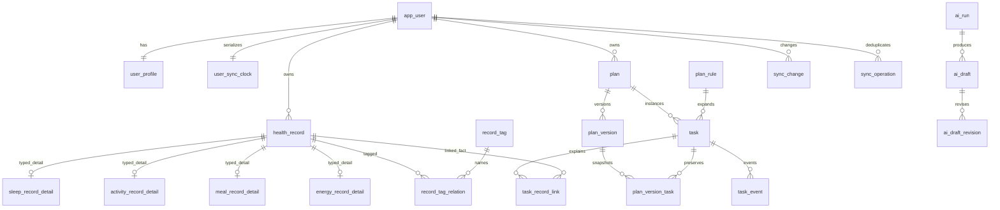
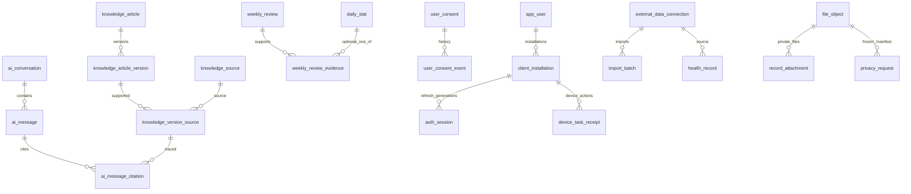

# 知衡：数据库设计与实施规划

版本：V1.0（建议设计，尚未实现）  
日期：2026 年 10 月 16 日  
适用项目：uni-app + Vue 3 手机 App，Java 21 + Spring Boot 模块化单体，MySQL 8.4 / InnoDB。  
配套文档：[知衡_后端功能与接口规划](知衡_后端功能与接口规划.md)。

## 1. 设计范围与落地原则

本设计面向成年大学生的日常生活记录、时间安排、计划执行与 AI 辅助回顾。数据库既能支撑比赛演示，也考虑账号隔离、历史版本、离线重放、异步取消、提醒撤销和数据清除等后续开发边界。这里的“健康”指生活行为记录和科普，不包含疾病诊断、药物剂量、疾病风险评分、体检解读或未经验证的医学指标。

共规划 **60 张表**，按真实职责划分，不按天/月复制同构表，也不为增加数量拆同义日志。P0 是手机核心闭环需要的结构；P1 为增强功能；P2 为设备、外部数据与多模态预留。表结构可随迁移提前建立，功能开关仍按阶段启用。不能把本规模默认塞回原先的两周压缩排期，须按本稿里程碑验收。

| 目标 | 设计方法 |
|---|---|
| 前端信息丰富但数据可靠 | 业务表是事实，统计表是缓存；AI 草稿必须确认才应用 |
| 计划能调整和恢复 | 长期 plan + 不可变 SEALED 版本 + 稳定 task 实例 |
| 断网和重试不重复 | REST/离线统一 operationId、业务唯一键和每用户提交序列 |
| 提醒可追踪 | 用户意愿与系统注册/投递分开，未知状态明确 UNKNOWN |
| 隐私能实际清除 | 冻结清单、写入栅栏、epoch、异步落地复核及恢复重放台账 |
| 2–3 人可逐步开发 | 单体按模块分包、单库事务、DB outbox，无需首版强加微服务/MQ/向量库 |

## 2. 命名、数据类型与公共列

### 2.1 数据库与接口约定

- 库建议 `zhiheng`；表名和列名 `snake_case`；接口字段 `camelCase`。默认字符集 `utf8mb4`；自然语言文本建议 `utf8mb4_0900_ai_ci`。账号代码、UUID、token 摘要等按 ASCII/binary 精确比较，避免大小写及重音折叠产生身份碰撞。
- 字段表中的 `ASCII` 是类型说明缩写，落 DDL 时明确写 `CHARACTER SET ascii COLLATE ascii_bin`；不是要求原样拼接表中所有类型文字为 SQL。
- `BIGINT UNSIGNED` 用于内部主键及版本/序号；API 中 **ID、rowVersion、changeSeq、epoch、版本序号均输出十进制字符串**，避免 JavaScript 数值精度丢失。UUID 使用 ASCII `CHAR(36)`，校验标准形式；可在真实体量验证后改为 BINARY(16)，不能同时混用。
- `DATETIME(3)` 一律按 UTC 读写，JDBC/连接会话与序列化统一 UTC；API 用带 `Z` 的 ISO 8601。DATE 是业务日，不是 UTC 截断；TIME 仅保存本地时分，拒绝超过 24 小时的 MySQL TIME 值。IANA 时区必须由服务端库核验。
- `NN` 表示 `NOT NULL`；“无默认”意味着创建必须显式给值，不能用空串、0、1900-01-01 占位；`NULL` 表示明确缺失。服务默认和 DB 默认区分：表内“默认”是建议 DDL 默认，时间由服务端统一写入；不依赖客户端系统时间。
- 枚举采用 `VARCHAR + CHECK`，不采用 MySQL ENUM；布尔 `TINYINT UNSIGNED + CHECK IN (0,1)`。所有文中枚举字段均生成白名单 CHECK；所有计数使用 UNSIGNED。日期、范围、配对空值规则同时落到 CHECK/服务校验。
- JSON 只装变长规则、白名单、校验报告或受限加密 envelope。可检索核心字段必须有列，不能用 JSON 吞掉所有业务。每类 JSON 设 schemaVersion、大小上限与后端 DTO 校验，接口不能提交任意 JSON Patch。
- 金额不在本项目记录；时长以分钟为主，不混毫秒/秒。比例从分子分母计算，不能只存百分比并丢掉样本数。
- `user_id` 一律从登录主体获取，客户端提供的归属 ID 无效。跨账号查对象统一 404；管理员默认也没有他人健康原文读取权。

### 2.2 公共列定义：每张表明确继承，详情表单独处理

| 方案 | 列及约束 | 使用方式 |
|---|---|---|
| CM：可变实体 | `id BIGINT UNSIGNED PK AUTO_INCREMENT`；`created_at DATETIME(3) NN`；`updated_at DATETIME(3) NN`；`row_version BIGINT UNSIGNED NN DEFAULT 1`；`deleted_at DATETIME(3) NULL` | 业务更新 `row_version=row_version+1`；普通删除先软删除，隐私工单按范围物理清除/脱敏 |
| CA：追加记录 | `id BIGINT UNSIGNED PK AUTO_INCREMENT`；`created_at DATETIME(3) NN` | 不额外套 updated_at、row_version、deleted_at。表中说明的消费/执行状态是明确例外，健康原文/证据仍不得静默覆写 |
| CD：记录详情 | `record_id BIGINT UNSIGNED PK FK health_record.id`；`created_at DATETIME(3) NN`；`updated_at DATETIME(3) NN` | **没有独立 id、row_version、deleted_at**，可见性/乐观版本跟主记录。user_id 与 detail_type 为本表业务/归属列 |
| 专用 sync_clock | 见该表专用字段 | 主键 user_id，不使用以上模板 |

以下每表字段表列的是 **公共列之外的完整业务列**。所有具有 user_id 且需被子表引用的 CM/CA 所有者实体补 `UNIQUE(user_id,id)`；关系表按表内声明的业务唯一键。共享字典、公共内容与后台权限没有 user_id。CM 的 `CHECK(row_version>=1)`、时间精度、`deleted_at` 可见性规则是统一迁移约束。

### 2.3 外键、唯一性与事务策略

同用户父子引用优先使用组合 FK `(user_id,parent_id)→parent(user_id,id)`；同计划版本还增加 plan_id 以防同账号串计划。父键必须有匹配唯一索引；列的类型、unsigned、字符集和排序规则必须匹配。循环 active 指针在所有表建好后 ALTER 添加，不以关闭外键检查代替正确建表顺序。

外键默认 `ON DELETE RESTRICT / ON UPDATE RESTRICT`。只有记录详情等明确从属且无独立意义的关系可在最终物理清除时用 CASCADE；正常软删不会触发级联。多态资源 ID、同步墓碑、outbox 的 aggregate_id 不做无法兑现的外键，而由服务白名单和归属检查约束。跨行“必须恰有一个详情”“SEALED 子项不可变”等不能仅靠单行 CHECK 完成，由统一事务入口保证并用巡检补证。

**不使用 `UNIQUE(user_id,name,deleted_at)` 维护活动唯一性。** MySQL 唯一键允许多行 NULL；活动单槽采用稳定唯一业务键恢复原行、权威 active 指针，或明确的 generated active_key（外部连接见表 55）。NULL 唯一只在需要多个“未设置值”时使用，例如无父 refresh 根会话、未分配的草稿任务。

MySQL CHECK 对表达式为 UNKNOWN 的情况不能替代 NOT NULL，必填字段必须显式 NN；并且不跨表查询。[MySQL CHECK 官方说明](https://dev.mysql.com/doc/refman/8.4/en/create-table-check-constraints.html)。外键索引和受限列有明确要求，迁移应按实际 MySQL 8.4 语法执行验证。[MySQL 外键官方说明](https://dev.mysql.com/doc/refman/8.4/en/create-table-foreign-keys.html)。

### 2.4 关键 CHECK 示例

以下示例说明约束形态，纳入相应表的唯一迁移，不与建表中同名约束重复执行。索引、FK 和完整枚举 CHECK 仍按各表字段补齐。

```sql
ALTER TABLE health_record
  ADD CONSTRAINT ck_record_source CHECK (
    (source_type = 'EXTERNAL' AND source_connection_id IS NOT NULL
      AND provider_record_key IS NOT NULL)
    OR
    (source_type IN ('MANUAL','AI_CONFIRMED') AND source_connection_id IS NULL
      AND provider_record_key IS NULL)
  );

ALTER TABLE weekly_review_evidence
  ADD CONSTRAINT ck_evidence_exactly_one CHECK (
    (evidence_type='DAILY_STAT' AND daily_stat_id IS NOT NULL
      AND record_id IS NULL AND task_event_id IS NULL)
    OR
    (evidence_type='RECORD' AND record_id IS NOT NULL
      AND daily_stat_id IS NULL AND task_event_id IS NULL)
    OR
    (evidence_type='TASK_EVENT' AND task_event_id IS NOT NULL
      AND daily_stat_id IS NULL AND record_id IS NULL)
  );

ALTER TABLE ai_draft
  ADD CONSTRAINT ck_draft_applied_receipt CHECK (
    (status='APPLIED' AND applied_at IS NOT NULL
      AND applied_resource_type IS NOT NULL AND applied_resource_id IS NOT NULL
      AND applied_operation_id IS NOT NULL)
    OR
    (status<>'APPLIED' AND applied_at IS NULL
      AND applied_resource_type IS NULL AND applied_resource_id IS NULL
      AND applied_operation_id IS NULL)
  );
```

详情父类型、固定任务修改确认、SEALED 快照不可变、当前指针指向 SEALED、引用资料真实存在以及每条主记录至少一个详情，仍须由服务事务保证，不能把跨表不变量伪装成已由上述 CHECK 全覆盖。

## 3. 全表目录与功能映射

**阶段数量：P0 44 张，P1 12 张，P2 4 张。业务字段 830 行（含归属/FK/衍生列，不含 CM/CA/CD 公共列）。**

| 模块 | 编号范围 | 支撑页面/功能 |
|---|---|---|
| 账号、安装与授权 | 01–09 | 登录、我的、授权及同步设备 |
| 目标与时间安排 | 10–13 | 引导、我的、计划约束 |
| 生活记录与标签附件 | 14–21 | 今日快速记录、趋势原始依据 |
| 计划、任务与执行 | 22–28 | 计划、今日任务、调整与历史恢复 |
| AI 会话与可应用草稿 | 29–34 | 助手、计划预览、记录草稿 |
| 审核科普资料 | 35–38 | 助手来源、科普与后台内容 |
| 统计与回顾 | 39–41 | 趋势、每周回顾 |
| 提醒与应用通知 | 42–44 | 提醒设置、通知中心 |
| 作业、文件、隐私与运营 | 45–50 | 作业运维、导出删除、反馈、配置 |
| 离线同步 | 51–53 | 离线队列、多端状态 |
| 设备与外部导入 | 54–56 | 后续手表、健康数据、语音/课表 |
| 后台权限 | 57–60 | 管理端内容/配置/审计权限 |

| 编号 | 表名 | 职责 | 阶段 | 公共列 |
|---|---|---|---|---|
| 01 | [app_user](#table-01) | 账号主体 | P0 | CM |
| 02 | [user_profile](#table-02) | 个人档案 | P0 | CM |
| 03 | [user_preference](#table-03) | 生活与交互偏好 | P0 | CM |
| 04 | [auth_identity](#table-04) | 第三方身份绑定 | P2 | CM |
| 05 | [auth_session](#table-05) | 刷新令牌代际与会话链 | P0 | CA |
| 06 | [auth_verification](#table-06) | 一次性身份验证挑战 | P0 | CA |
| 07 | [client_installation](#table-07) | 客户端安装与同步租约 | P0 | CM |
| 08 | [user_consent](#table-08) | 按用途的当前授权 | P0 | CM |
| 09 | [user_consent_event](#table-09) | 授权变更证据 | P0 | CA |
| 10 | [goal_definition](#table-10) | 目标字典 | P0 | CM |
| 11 | [user_goal](#table-11) | 用户生活目标 | P0 | CM |
| 12 | [availability_rule](#table-12) | 每周时间安排规则 | P0 | CM |
| 13 | [availability_exception](#table-13) | 指定日期时间例外 | P0 | CM |
| 14 | [health_record](#table-14) | 生活记录主表 | P0 | CM |
| 15 | [sleep_record_detail](#table-15) | 睡眠记录详情 | P0 | CD |
| 16 | [activity_record_detail](#table-16) | 实际活动记录详情 | P0 | CD |
| 17 | [meal_record_detail](#table-17) | 饮食习惯记录详情 | P0 | CD |
| 18 | [energy_record_detail](#table-18) | 主观精力记录详情 | P0 | CD |
| 19 | [record_tag](#table-19) | 用户记录标签 | P0 | CM |
| 20 | [record_tag_relation](#table-20) | 记录与标签关系 | P0 | CA |
| 21 | [record_attachment](#table-21) | 记录附件关系 | P1 | CA |
| 22 | [plan](#table-22) | 计划长期主体 | P0 | CM |
| 23 | [plan_version](#table-23) | 计划版本与封存 | P0 | CM |
| 24 | [task](#table-24) | 稳定执行实例 | P0 | CM |
| 25 | [plan_version_task](#table-25) | 计划版本任务快照 | P0 | CM |
| 26 | [plan_rule](#table-26) | 循环任务逻辑规则 | P1 | CM |
| 27 | [task_event](#table-27) | 任务执行与调整事件 | P0 | CA |
| 28 | [task_record_link](#table-28) | 任务与实际记录关联 | P0 | CA |
| 29 | [ai_conversation](#table-29) | 助手会话 | P0 | CM |
| 30 | [ai_message](#table-30) | 会话消息与操作卡片 | P0 | CA |
| 31 | [ai_run](#table-31) | AI 运行与异步控制 | P0 | CM |
| 32 | [ai_draft](#table-32) | 可应用 AI 草稿 | P0 | CM |
| 33 | [ai_draft_revision](#table-33) | 草稿不可变修订 | P0 | CA |
| 34 | [ai_message_citation](#table-34) | 消息可核验资料引用 | P1 | CA |
| 35 | [knowledge_article](#table-35) | 科普知识长期条目 | P0 | CM |
| 36 | [knowledge_article_version](#table-36) | 知识审核与发布快照 | P0 | CM |
| 37 | [knowledge_source](#table-37) | 外部权威来源登记 | P0 | CM |
| 38 | [knowledge_version_source](#table-38) | 知识版本与来源关系 | P0 | CA |
| 39 | [daily_stat](#table-39) | 可重建每日统计 | P0 | CM |
| 40 | [weekly_review](#table-40) | 每周回顾快照 | P1 | CM |
| 41 | [weekly_review_evidence](#table-41) | 周报结论证据 | P1 | CA |
| 42 | [reminder_rule](#table-42) | 提醒意愿与规则 | P0 | CM |
| 43 | [reminder_delivery](#table-43) | 一次系统提醒调度/投递尝试 | P1 | CM |
| 44 | [notification_inbox](#table-44) | 应用内通知 | P1 | CM |
| 45 | [outbox_event](#table-45) | 事务事件待办 | P0 | CM |
| 46 | [file_object](#table-46) | 私有文件与保留策略 | P0 | CM |
| 47 | [privacy_request](#table-47) | 导出、删除预览与后台工单 | P0 | CM |
| 48 | [audit_log](#table-48) | 最小安全审计 | P0 | CA |
| 49 | [feedback_ticket](#table-49) | 用户反馈工单 | P1 | CM |
| 50 | [app_configuration](#table-50) | 可审计配置 | P0 | CM |
| 51 | [user_sync_clock](#table-51) | 每用户已提交同步时钟 | P0 | 专用主键，不继承 CM/CA/CD |
| 52 | [sync_change](#table-52) | 用户增量与删除墓碑 | P0 | CA |
| 53 | [sync_operation](#table-53) | 跨 REST/离线命令幂等回执 | P0 | CA |
| 54 | [device_task_receipt](#table-54) | 手表任务动作回执 | P2 | CA |
| 55 | [external_data_connection](#table-55) | 外部数据授权连接 | P2 | CM |
| 56 | [import_batch](#table-56) | 导入任务与校验摘要 | P2 | CM |
| 57 | [sys_role](#table-57) | 后台角色 | P1 | CM |
| 58 | [sys_permission](#table-58) | 后台权限目录 | P1 | CM |
| 59 | [user_role_assignment](#table-59) | 账号角色分配 | P1 | CM |
| 60 | [role_permission](#table-60) | 角色权限关系 | P1 | CA |

## 4. 逐表字段、约束与写入规则

<a id="table-01"></a>

### 4.01 `app_user` — 账号主体（P0）

职责：账号状态、登录标识和数据写入栅栏；不承载生活记录。

公共列：继承 **CM**。

| 字段 | MySQL 类型 | 必填/默认 | 含义与限制 |
|---|---|---|---|
| `account_no` | `CHAR(26) ASCII` | NN，无默认 | 公开账号编号，创建后不复用 |
| `password_hash` | `VARCHAR(255) ASCII` | NULL | 自适应密码哈希，第三方登录账号可空 |
| `password_updated_at` | `DATETIME(3)` | NULL | 密码最近更新 UTC 时间 |
| `status` | `VARCHAR(16)` | NN，默认 ACTIVE | ACTIVE / LOCKED / DELETING / DELETED |
| `security_version` | `BIGINT UNSIGNED` | NN，默认 1 | 密码变更、全端退出时递增，令牌需核对 |
| `data_write_fence` | `VARCHAR(24)` | NN，默认 OPEN | OPEN / ERASING / ACCOUNT_DELETING |
| `registered_at` | `DATETIME(3)` | NN，无默认 | 注册成功时间 |
| `last_login_at` | `DATETIME(3)` | NULL | 最近成功登录，低频异步汇总 |
| `lock_until` | `DATETIME(3)` | NULL | 临时账号锁定截止 |
| `delete_requested_at` | `DATETIME(3)` | NULL | 注销申请受理时间 |
| `anonymized_at` | `DATETIME(3)` | NULL | 敏感标识清理完成时间 |
| `email_lookup_hmac` | `BINARY(32)` | NN，无默认 | 规范化邮箱的域分离 HMAC，用于登录和唯一去重，不存邮箱明文 |
| `email_cipher` | `VARBINARY(2048)` | NN，无默认 | 邮箱认证加密密文；注销后替换为不可恢复占位 |
| `email_key_ref` | `VARCHAR(128) ASCII` | NN，无默认 | 邮箱密钥引用 |
| `email_verified_at` | `DATETIME(3)` | NN，无默认 | 首次验证码验证通过时间 |
| `registration_policy_version` | `VARCHAR(40) ASCII` | NN，无默认 | 注册时明确同意的服务条款/隐私说明组合版本 |
| `registration_policy_accepted_at` | `DATETIME(3)` | NN，无默认 | 服务端确认接受时间，不能代替可撤回AI等独立授权 |

主键、外键、唯一与查询索引：PK id；UNIQUE(account_no)、UNIQUE(email_lookup_hmac)；INDEX(status,delete_requested_at,id)。邮箱首版仅 EMAIL 渠道；注销将原 email_lookup_hmac 替换为不可复用随机 tombstone、email_cipher/key_ref 清为不可恢复占位，原邮箱是否允许重新注册由产品规则决定，不使用 deleted_at 参与唯一键。

关联和写入规则：注册事务同时创建 profile、preference、sync_clock；账号被锁不直接删除记录。所有者外键引用本表 id。示例体验使用客户端模拟数据，不落真实用户表。 account DTO 输入为邮箱，先执行版本化归一化再 HMAC 查询；不擅自删除点号或 + 后缀，大小写策略固定并在注册/登录/找回一致。邮箱更改先验证新地址再原子更新 HMAC/密文/安全版本。

<a id="table-02"></a>

### 4.02 `user_profile` — 个人档案（P0）

职责：保存最小必要的展示与时间设置，不强制收集身体尺寸或病史。

公共列：继承 **CM**。

| 字段 | MySQL 类型 | 必填/默认 | 含义与限制 |
|---|---|---|---|
| `user_id` | `BIGINT UNSIGNED` | NN，无默认 | 账号 FK |
| `display_name` | `VARCHAR(60)` | NN，无默认 | 用户昵称，1–60 字 |
| `avatar_file_id` | `BIGINT UNSIGNED` | NULL | 头像私有文件 FK |
| `time_zone` | `VARCHAR(64) ASCII` | NN，无默认 | IANA 时区，如 Asia/Shanghai，客户端首次确认 |
| `locale` | `VARCHAR(20) ASCII` | NN，默认 zh-CN | 语言区域 |
| `adult_confirmed_at` | `DATETIME(3)` | NN，无默认 | 成年人确认时间，不保存完整出生日期 |
| `onboarding_step` | `VARCHAR(24)` | NN，默认 GOALS | GOALS / AVAILABILITY / PREFERENCES / COMPLETED |
| `onboarding_completed_at` | `DATETIME(3)` | NULL | 引导结束时间 |
| `bio_cipher` | `VARBINARY(2048)` | NULL | 可选个人备注密文 |
| `encryption_key_ref` | `VARCHAR(128) ASCII` | NULL | 备注加密密钥引用 |
| `week_start_day` | `TINYINT UNSIGNED` | NN，默认 1 | 1–7，周起始星期 |
| `profile_completed_at` | `DATETIME(3)` | NULL | 首次完成核心档案时间 |

主键、外键、唯一与查询索引：UNIQUE(user_id)；FK user_id→app_user；头像 FK file_object，并验证同账号用途 AVATAR；CHECK week_start_day BETWEEN 1 AND 7。

关联和写入规则：时区修改只影响未来安排和新建记录；历史业务日、历史任务快照不重写。密文与 key_ref 同空同有，头像删除后置空，禁止指向其他用户文件。

<a id="table-03"></a>

### 4.03 `user_preference` — 生活与交互偏好（P0）

职责：偏好是计划约束输入；是否授权调用 AI 由 consent 控制。

公共列：继承 **CM**。

| 字段 | MySQL 类型 | 必填/默认 | 含义与限制 |
|---|---|---|---|
| `user_id` | `BIGINT UNSIGNED` | NN，无默认 | 账号 FK |
| `preferred_wake_time` | `TIME` | NULL | 期望起床本地时间，时分精度 |
| `preferred_bed_time` | `TIME` | NULL | 期望就寝时间 |
| `preferred_activity_types_json` | `JSON` | NN，无默认 | 活动类型白名单数组，允许空数组 |
| `excluded_activity_types_json` | `JSON` | NN，无默认 | 不愿推荐的活动数组 |
| `daily_task_limit` | `TINYINT UNSIGNED` | NN，默认 4 | 建议 1–12，程序硬上限 12 |
| `default_task_minutes` | `SMALLINT UNSIGNED` | NN，默认 15 | 手工新任务建议时长，1–240 分钟 |
| `preferred_session_minutes` | `SMALLINT UNSIGNED` | NULL | 用户愿意单次投入时长，1–240 |
| `plan_tone` | `VARCHAR(16)` | NN，默认 NEUTRAL | NEUTRAL / ENCOURAGING / CONCISE |
| `theme_mode` | `VARCHAR(12)` | NN，默认 SYSTEM | SYSTEM / LIGHT / DARK |
| `reduced_motion` | `TINYINT UNSIGNED` | NN，默认 0 | 0 / 1，减少动效 |
| `font_scale` | `DECIMAL(3,2)` | NN，默认 1.00 | 0.80–2.00，前端仍须适配 |
| `quiet_hours_enabled` | `TINYINT UNSIGNED` | NN，默认 0 | 是否启用免打扰 |
| `quiet_start` | `TIME` | NULL | 本地免打扰开始 |
| `quiet_end` | `TIME` | NULL | 本地免打扰结束，可跨午夜 |
| `preference_schema_version` | `SMALLINT UNSIGNED` | NN，默认 1 | JSON 与规则解释版本 |

主键、外键、唯一与查询索引：UNIQUE(user_id)；FK user_id→app_user；CHECK 布尔、任务数量、时长和字号范围；JSON 数组形态由服务校验，禁止未知活动码。

关联和写入规则：开启免打扰必须同时提供起止时间，开始等于结束不解释为全天。更新后已有计划不自动变更，可产生调整草稿；尚未投递提醒需重算。

<a id="table-04"></a>

### 4.04 `auth_identity` — 第三方身份绑定（P2）

职责：为最终确认的平台账号登录保留，不把健康数据授权混作身份授权。

公共列：继承 **CM**。

| 字段 | MySQL 类型 | 必填/默认 | 含义与限制 |
|---|---|---|---|
| `user_id` | `BIGINT UNSIGNED` | NN，无默认 | 绑定账号 |
| `provider` | `VARCHAR(32) ASCII` | NN，无默认 | 启用的身份提供方代码 |
| `provider_tenant` | `VARCHAR(100) ASCII` | NN，无默认 | 应用或租户命名空间 |
| `subject_hash` | `BINARY(32)` | NN，无默认 | provider subject 的域分离 HMAC |
| `subject_cipher` | `VARBINARY(2048)` | NULL | 确有重新绑定需要时保存的 subject 密文 |
| `union_subject_hash` | `BINARY(32)` | NULL | 提供方跨应用标识 HMAC，不盲目自动合并账号 |
| `binding_status` | `VARCHAR(16)` | NN，默认 ACTIVE | ACTIVE / REVOKED |
| `bound_at` | `DATETIME(3)` | NN，无默认 | 首次完成绑定时间 |
| `last_authenticated_at` | `DATETIME(3)` | NULL | 最近该方式登录 |
| `revoked_at` | `DATETIME(3)` | NULL | 解除绑定时间 |
| `authorization_revision` | `BIGINT UNSIGNED` | NN，默认 1 | 绑定凭据代际 |
| `encryption_key_ref` | `VARCHAR(128) ASCII` | NULL | 密钥引用 |

主键、外键、唯一与查询索引：UNIQUE(provider,provider_tenant,subject_hash)；INDEX(user_id,binding_status,id)；FK user_id→app_user。唯一标识不随软删除释放。

关联和写入规则：先核验第三方签名、audience、nonce，再绑定；解除最后一种可用登录方式应被阻止或先设置密码。身份表不保存运动健康 access token。

<a id="table-05"></a>

### 4.05 `auth_session` — 刷新令牌代际与会话链（P0）

职责：保留 refresh token 旋转链，发现旧令牌复用时撤销整个 family。

公共列：继承 **CA（每代令牌一行；受控填写消费/撤销字段）**。

| 字段 | MySQL 类型 | 必填/默认 | 含义与限制 |
|---|---|---|---|
| `user_id` | `BIGINT UNSIGNED` | NN，无默认 | 登录账号 |
| `installation_id` | `BIGINT UNSIGNED` | NN，无默认 | 本机安装记录 FK |
| `family_id` | `CHAR(36) ASCII` | NN，无默认 | 一次登录生成的随机 UUID，整链一致 |
| `parent_session_id` | `BIGINT UNSIGNED` | NULL | 上一代 session FK |
| `replaced_by_session_id` | `BIGINT UNSIGNED` | NULL | 旋转后的下一代 FK |
| `token_hash` | `BINARY(32)` | NN，无默认 | 高熵 refresh token 哈希，不存原 token |
| `security_version` | `BIGINT UNSIGNED` | NN，无默认 | 签发时账号安全版本 |
| `issued_at` | `DATETIME(3)` | NN，无默认 | 本代签发时间 |
| `expires_at` | `DATETIME(3)` | NN，无默认 | 本代令牌截止 |
| `family_expires_at` | `DATETIME(3)` | NN，无默认 | 绝对会话截止，不因旋转无限续期 |
| `consumed_at` | `DATETIME(3)` | NULL | 首次旋转消费时间 |
| `revoked_at` | `DATETIME(3)` | NULL | 撤销生效时间 |
| `revoke_reason` | `VARCHAR(32)` | NULL | LOGOUT / REUSE / PASSWORD_CHANGED / ACCOUNT_DELETED 等 |
| `client_label` | `VARCHAR(100)` | NULL | 安全页面展示的设备名称，客户端文本需清洗 |
| `ip_hash` | `BINARY(32)` | NULL | 短期安全排查 IP 的 HMAC，非原 IP |
| `user_agent_digest` | `BINARY(32)` | NULL | 客户端特征摘要，非设备指纹身份 |
| `client_audience` | `VARCHAR(12) ASCII` | NN，无默认 | MOBILE / ADMIN，签发与refresh旋转严格继承 |
| `generation` | `INT UNSIGNED` | NN，默认 1 | family内代际，子代=父代+1 |

主键、外键、唯一与查询索引：UNIQUE(token_hash)、UNIQUE(parent_session_id)（根节点可多行 NULL，非空父代只能有一个子代）；INDEX(user_id,family_id,id)、INDEX(expires_at,id)、INDEX(installation_id,revoked_at,id)；parent/replaced_by 均同用户 FK。

关联和写入规则：旋转事务锁旧行，验证未消费/未撤销/未过期与 security_version 后插入新代，再回填 consumed_at/replaced_by。已消费 token 再次使用撤销同 family 全部代；注销撤销所有 family。登录/refresh 不写业务 sync_operation，客户端须串行刷新。 ADMIN 会话必须绑定 WEB 安装并有有效后台角色，MOBILE 不得用 refresh 换 ADMIN；JWT audience 与 session 一致，后台 token 不用于代用户读取健康记录。generation 与 family/parent 一起核验。

<a id="table-06"></a>

### 4.06 `auth_verification` — 一次性身份验证挑战（P0）

职责：注册、找回密码或敏感操作二次核验；渠道未配置时不展示不可用入口。

公共列：继承 **CA（允许受控累计尝试与消费）**。

| 字段 | MySQL 类型 | 必填/默认 | 含义与限制 |
|---|---|---|---|
| `challenge_id` | `CHAR(36) ASCII` | NN，无默认 | 随机挑战编号 |
| `user_id` | `BIGINT UNSIGNED` | NULL | 未注册场景可空 |
| `purpose` | `VARCHAR(24)` | NN，无默认 | REGISTER / RESET_PASSWORD / REAUTH / CONTACT_CHANGE |
| `channel` | `VARCHAR(16)` | NN，无默认 | P0 固定 EMAIL；其他验证渠道启用时另行迁移/校验，不提供伪短信入口 |
| `destination_hash` | `BINARY(32)` | NULL | 目标地址域分离 HMAC |
| `destination_cipher` | `VARBINARY(2048)` | NULL | 确需短期投递时加密地址 |
| `proof_hash` | `BINARY(32)` | NN，无默认 | 验证码加盐/HMAC，不保存原码 |
| `encryption_key_ref` | `VARCHAR(128) ASCII` | NULL | 短期收件地址密钥引用 |
| `expires_at` | `DATETIME(3)` | NN，无默认 | 挑战过期，建议验证码 5–10 分钟 |
| `attempt_count` | `TINYINT UNSIGNED` | NN，默认 0 | 失败尝试次数 |
| `max_attempts` | `TINYINT UNSIGNED` | NN，默认 5 | 本挑战尝试上限 |
| `consumed_at` | `DATETIME(3)` | NULL | 成功消费，单次使用 |
| `locked_at` | `DATETIME(3)` | NULL | 超尝试上限时间 |
| `request_ip_hash` | `BINARY(32)` | NULL | 短期防滥用摘要 |
| `invalidated_at` | `DATETIME(3)` | NULL | 重发/安全撤销使旧挑战作废的时间；验证须为空 |
| `client_audience` | `VARCHAR(12) ASCII` | NN，无默认 | MOBILE / ADMIN；REAUTH凭证只能用于原audience |

主键、外键、唯一与查询索引：UNIQUE(challenge_id)；INDEX(destination_hash,purpose,created_at)、INDEX(expires_at,id)；CHECK max_attempts BETWEEN 1 AND 10 且 attempt_count<=max_attempts。

关联和写入规则：挑战行锁下核验并消费。邮件/短信投递依赖独立配置，失败不泄露账号是否存在。验证码限流需结合渠道和 IP，数据库记录不能代替网关限流。 proof_hash 使用独立 pepper 的 HMAC，重发新挑战时使同目标同用途旧挑战失效；密码重设成功递增 security_version 并撤全部 session。 REGISTER 仅 MOBILE；REAUTH challenge 绑定账号、用途、audience，核验收件主体，不能将手机重认证凭据用于后台扩权。

<a id="table-07"></a>

### 4.07 `client_installation` — 客户端安装与同步租约（P0）

职责：区分同账号多次安装，存同步进度、初始化租约与实际能力。

公共列：继承 **CM**。

| 字段 | MySQL 类型 | 必填/默认 | 含义与限制 |
|---|---|---|---|
| `user_id` | `BIGINT UNSIGNED` | NN，无默认 | 安装所属账号 |
| `installation_key` | `CHAR(36) ASCII` | NN，无默认 | 客户端生成安装 UUID，重装重新生成 |
| `platform` | `VARCHAR(20)` | NN，无默认 | ANDROID / HARMONYOS / IOS / WEB，按实际支持开放 |
| `app_version` | `VARCHAR(32) ASCII` | NN，无默认 | 客户端版本 |
| `os_version` | `VARCHAR(64)` | NULL | 系统版本，避免过细设备指纹 |
| `device_label` | `VARCHAR(100)` | NULL | 用户可辨识名称 |
| `capabilities_json` | `JSON` | NN，无默认 | 已验证能力，如 localReminder、watchRelay；非权限授权凭证 |
| `last_seen_at` | `DATETIME(3)` | NULL | 最近在线 |
| `last_ack_seq` | `BIGINT UNSIGNED` | NN，默认 0 | 已完整本地应用并确认的 seq |
| `last_ack_at` | `DATETIME(3)` | NULL | 确认时间 |
| `bootstrap_id` | `CHAR(36) ASCII` | NULL | 当前全量初始化租约编号 |
| `bootstrap_from_seq` | `BIGINT UNSIGNED` | NULL | C0，高水位起点 |
| `bootstrap_expires_at` | `DATETIME(3)` | NULL | 建议 2 小时租约 |
| `bootstrap_epoch` | `BIGINT UNSIGNED` | NULL | 初始化捕获数据代际 |
| `bootstrap_progress_json` | `JSON` | NULL | 白名单实体及主键分页进度，不含原始健康内容 |
| `notification_permission` | `VARCHAR(16)` | NN，默认 UNKNOWN | UNKNOWN / GRANTED / DENIED，由客户端报告，不能证明投递 |
| `revoked_at` | `DATETIME(3)` | NULL | 移除本机或停止同步 |
| `installation_kind` | `VARCHAR(12)` | NN，默认 PHONE | PHONE / WATCH / WEB，WEB 可用于管理端 |
| `parent_installation_id` | `BIGINT UNSIGNED` | NULL | WATCH 必填且指向同用户 PHONE，其他种类为空 |
| `pairing_token_hash` | `BINARY(32)` | NULL | P2 一次性配对 token 哈希，消费后清空 |
| `pairing_expires_at` | `DATETIME(3)` | NULL | 配对码短期有效截止 |
| `device_scope_json` | `JSON` | NULL | WATCH 仅最小任务投影/白名单动作，非完整用户权限 |
| `device_credential_hash` | `BINARY(32)` | NULL | 手表专用凭据哈希，不复用手机 refresh token |
| `credential_expires_at` | `DATETIME(3)` | NULL | 设备凭据截止 |
| `credential_revision` | `BIGINT UNSIGNED` | NN，默认 1 | 解绑/换凭据递增，旧设备命令拒绝 |
| `last_delivered_seq` | `BIGINT UNSIGNED` | NN，默认 0 | 服务器已交付最高 seq，ack 不得超过该值 |
| `sync_state` | `VARCHAR(16)` | NN，默认 UNINITIALIZED | UNINITIALIZED / INITIALIZING / READY |
| `sync_epoch` | `BIGINT UNSIGNED` | NULL | READY 时已初始化的数据代际；普通增量/ack与当前clock核对 |
| `bootstrap_completed_at` | `DATETIME(3)` | NULL | 全量分页和C0之后增量追平确认时间 |

主键、外键、唯一与查询索引：UNIQUE(user_id,installation_key)、UNIQUE(user_id,id)；INDEX(user_id,last_seen_at,id)、INDEX(bootstrap_expires_at,id)；FK user_id→app_user。 parent 同用户自引用 FK；UNIQUE(pairing_token_hash)、UNIQUE(device_credential_hash) 允许多个未配置 NULL，非空凭据必须唯一；CHECK last_ack_seq<=last_delivered_seq。

关联和写入规则：初始化进入 INITIALIZING，bootstrap 页/初始化阶段增量/完成核未过期 2 小时租约及 bootstrap_epoch；追平完成设置 READY、sync_epoch=bootstrap_epoch、bootstrap_completed_at，last_delivered_seq 至少为 C0（即使没有新事件），才允许 ack(C0)。READY 后普通增量和 ack 核安装有效、sync_epoch=当前 epoch、游标保留窗，不再核过期 bootstrap 租约。epoch 改变即清租约/回 UNINITIALIZED 并返回 DATA_EPOCH_CHANGED。last_ack_seq 单调且<=last_delivered_seq。WEB 会话也有安装；WATCH 仅同用户 PHONE 父安装，专用凭据限任务投影/动作；配对码事务消费，解绑撤凭据并递增 credential_revision。

<a id="table-08"></a>

### 4.08 `user_consent` — 按用途的当前授权（P0）

职责：每账号每用途一行，当前状态与不可变事件分离。

公共列：继承 **CM**。

| 字段 | MySQL 类型 | 必填/默认 | 含义与限制 |
|---|---|---|---|
| `user_id` | `BIGINT UNSIGNED` | NN，无默认 | 授权主体 |
| `purpose_code` | `VARCHAR(32) ASCII` | NN，无默认 | AI_PROCESSING / NOTIFICATION / EXTERNAL_HEALTH |
| `status` | `VARCHAR(16)` | NN，默认 NOT_GRANTED | NOT_GRANTED / GRANTED / REVOKED |
| `policy_version` | `VARCHAR(40) ASCII` | NN，无默认 | 被展示的说明版本 |
| `scope_json` | `JSON` | NN，无默认 | 授权能力白名单，不允许通配全部数据 |
| `consent_version` | `BIGINT UNSIGNED` | NN，默认 1 | 每次授权状态或范围变化递增 |
| `granted_at` | `DATETIME(3)` | NULL | 最近允许时间 |
| `revoked_at` | `DATETIME(3)` | NULL | 最近撤回时间 |
| `expires_at` | `DATETIME(3)` | NULL | 如用途限定有效期 |
| `installation_id` | `BIGINT UNSIGNED` | NULL | 授权发起设备 |
| `last_event_id` | `BIGINT UNSIGNED` | NULL | 最后一条 consent_event |

主键、外键、唯一与查询索引：UNIQUE(user_id,purpose_code)、UNIQUE(user_id,id)；INDEX(user_id,status,purpose_code)；FK installation 同用户；CHECK status 白名单。

关联和写入规则：授权与事件在同一事务写入，撤回后停止下一次外部调用；历史删除须用户另选范围。worker 捕获 consent_version，落结果前复核当前 GRANTED 且版本一致，拒绝撤回前排队请求。

<a id="table-09"></a>

### 4.09 `user_consent_event` — 授权变更证据（P0）

职责：追加记录授权/撤回所见说明和动作；不是原始页面录屏。

公共列：继承 **CA**。

| 字段 | MySQL 类型 | 必填/默认 | 含义与限制 |
|---|---|---|---|
| `user_id` | `BIGINT UNSIGNED` | NN，无默认 | 授权主体 |
| `consent_id` | `BIGINT UNSIGNED` | NN，无默认 | 当前授权行 FK |
| `event_type` | `VARCHAR(16)` | NN，无默认 | GRANT / REVOKE / UPDATE_SCOPE / EXPIRE |
| `consent_version` | `BIGINT UNSIGNED` | NN，无默认 | 变化后的授权版本 |
| `policy_version` | `VARCHAR(40) ASCII` | NN，无默认 | 当时所见说明版本 |
| `scope_json` | `JSON` | NN，无默认 | 当时生效范围白名单 |
| `occurred_at` | `DATETIME(3)` | NN，无默认 | 服务器确认时间 |
| `installation_id` | `BIGINT UNSIGNED` | NULL | 动作设备 |
| `operation_id` | `CHAR(36) ASCII` | NN，无默认 | 可重试操作号 |
| `notice_digest` | `BINARY(32)` | NN，无默认 | 被展示授权说明的摘要 |

主键、外键、唯一与查询索引：UNIQUE(consent_id,consent_version)、UNIQUE(user_id,operation_id)；INDEX(user_id,occurred_at,id)；FK(user_id,consent_id)→user_consent。

关联和写入规则：仅允许追加；隐私清理按台账允许保留最小必要证明，期限作为工程配置并另核政策。撤回通知授权不把任务改为完成。

<a id="table-10"></a>

### 4.10 `goal_definition` — 目标字典（P0）

职责：维护可选择的生活目标及可接受参数，不定义疾病评分。

公共列：继承 **CM**。

| 字段 | MySQL 类型 | 必填/默认 | 含义与限制 |
|---|---|---|---|
| `code` | `VARCHAR(32) ASCII` | NN，无默认 | REGULAR_SLEEP / DAILY_ACTIVITY / LIFE_RECORD / CUSTOM 等稳定码 |
| `name` | `VARCHAR(80)` | NN，无默认 | 目标名称 |
| `description` | `VARCHAR(500)` | NN，无默认 | 用户可理解的目标解释 |
| `goal_category` | `VARCHAR(24)` | NN，无默认 | ROUTINE / ACTIVITY / RECORDING / CUSTOM |
| `parameter_schema_json` | `JSON` | NN，无默认 | 允许的目标字段、单位、范围和是否可空 |
| `suggested_parameters_json` | `JSON` | NULL | 非医疗性质的可编辑示例参数 |
| `icon_code` | `VARCHAR(40) ASCII` | NULL | 前端图标白名单 |
| `sort_order` | `INT` | NN，默认 0 | 展示排序 |
| `status` | `VARCHAR(12)` | NN，默认 ACTIVE | ACTIVE / DISABLED |
| `schema_version` | `SMALLINT UNSIGNED` | NN，默认 1 | 参数解释版本 |

主键、外键、唯一与查询索引：UNIQUE(code)；INDEX(status,sort_order,id)；无 user_id，全局字典。

关联和写入规则：禁用不删除已有用户目标；字典变更不静默覆盖用户参数。需不兼容变更时升级 schema_version，已有目标保留参数快照。

<a id="table-11"></a>

### 4.11 `user_goal` — 用户生活目标（P0）

职责：保存用户确认的目标及有效周期，给计划生成提供约束。

公共列：继承 **CM**。

| 字段 | MySQL 类型 | 必填/默认 | 含义与限制 |
|---|---|---|---|
| `user_id` | `BIGINT UNSIGNED` | NN，无默认 | 账号 |
| `goal_definition_id` | `BIGINT UNSIGNED` | NN，无默认 | 目标字典 FK |
| `display_name` | `VARCHAR(80)` | NN，无默认 | 该用户的目标名称快照 |
| `parameters_json` | `JSON` | NN，无默认 | 按目标 schema 校验，不能保存自由医疗指令 |
| `parameter_schema_version` | `SMALLINT UNSIGNED` | NN，无默认 | 采用的字典解释版本 |
| `priority` | `TINYINT UNSIGNED` | NN，默认 1 | 1–5，值越大优先级越高 |
| `status` | `VARCHAR(16)` | NN，默认 ACTIVE | ACTIVE / PAUSED / COMPLETED / ARCHIVED |
| `start_local_date` | `DATE` | NN，无默认 | 有效开始日 |
| `end_local_date` | `DATE` | NULL | 可选目标结束日 |
| `goal_time_zone` | `VARCHAR(64) ASCII` | NN，无默认 | 设置目标时区 |
| `success_criterion_json` | `JSON` | NULL | 用户确认的可测行为口径，不是医疗效果 |
| `motivation_cipher` | `VARBINARY(4096)` | NULL | 可选动机备注密文 |
| `encryption_key_ref` | `VARCHAR(128) ASCII` | NULL | 密钥引用 |
| `completed_at` | `DATETIME(3)` | NULL | 用户确认目标完成时间 |

主键、外键、唯一与查询索引：UNIQUE(user_id,id)；INDEX(user_id,status,priority,id)；FK user_id→app_user、definition→goal_definition；CHECK 日期范围、priority BETWEEN 1 AND 5。

关联和写入规则：同一字典可以多个周期目标，禁止业务时间范围内重复 ACTIVE 的同参数目标由锁账号后检查；不会因为完成一天任务自动宣称目标达成。

<a id="table-12"></a>

### 4.12 `availability_rule` — 每周时间安排规则（P0）

职责：用本地星期和分钟区间表达空闲、忙碌与保留休息。

公共列：继承 **CM**。

| 字段 | MySQL 类型 | 必填/默认 | 含义与限制 |
|---|---|---|---|
| `user_id` | `BIGINT UNSIGNED` | NN，无默认 | 账号 |
| `label` | `VARCHAR(80)` | NN，无默认 | 课程、社团或休息等自定义名称 |
| `rule_kind` | `VARCHAR(16)` | NN，无默认 | AVAILABLE / BUSY / RESERVED_REST |
| `weekday` | `TINYINT UNSIGNED` | NN，无默认 | 1–7，ISO 星期 |
| `start_minute` | `SMALLINT UNSIGNED` | NN，无默认 | 0–1439，本地当日开始分钟 |
| `end_minute` | `SMALLINT UNSIGNED` | NN，无默认 | 0–1439，本地结束分钟，配合 end_day_offset |
| `time_zone` | `VARCHAR(64) ASCII` | NN，无默认 | 规则的 IANA 时区 |
| `valid_from` | `DATE` | NN，无默认 | 本地有效开始日 |
| `valid_until` | `DATE` | NULL | 本地有效结束日 |
| `priority` | `SMALLINT` | NN，默认 0 | 同类覆盖优先级 |
| `is_enabled` | `TINYINT UNSIGNED` | NN，默认 1 | 0 / 1 |
| `source_type` | `VARCHAR(16)` | NN，默认 MANUAL | MANUAL / AI_CONFIRMED / COURSE_IMPORT |
| `source_batch_id` | `BIGINT UNSIGNED` | NULL | P2 课程导入批次 |
| `end_day_offset` | `TINYINT UNSIGNED` | NN，默认 0 | 0 当日 / 1 次日；允许跨午夜，不用end<start推断 |

主键、外键、唯一与查询索引：UNIQUE(user_id,id)；INDEX(user_id,is_enabled,weekday,valid_from,id)；CHECK start_minute BETWEEN 0 AND 1439、end_minute BETWEEN 0 AND 1439、end_day_offset IN (0,1)、end_minute+1440*end_day_offset-start_minute BETWEEN 1 AND 1440、weekday BETWEEN 1 AND 7、valid_until IS NULL OR valid_until>=valid_from；source_batch 同用户 FK。

关联和写入规则：跨午夜保留一条逻辑规则，计算时拆当日与次日片段，不隐式修改次日行。BUSY 和 RESERVED_REST 优先排除，AVAILABLE 不覆盖忙碌；同级矛盾要求用户确认。规则变更不自动改现行计划。生效期以起始日判断，越界片段延伸到次日；DST 不存在/歧义的具体日期需显式处理，不能默认固定 UTC offset。

<a id="table-13"></a>

### 4.13 `availability_exception` — 指定日期时间例外（P0）

职责：按用户和起始日期保存整日例外；slots 为受限值对象数组，整日表单用一行 row_version 避免跨区间竞争。

公共列：继承 **CM**。

| 字段 | MySQL 类型 | 必填/默认 | 含义与限制 |
|---|---|---|---|
| `user_id` | `BIGINT UNSIGNED` | NN，无默认 | 账号 |
| `exception_date` | `DATE` | NN，无默认 | 例外起始业务日 |
| `time_zone` | `VARCHAR(64) ASCII` | NN，无默认 | 解释所有 slot 的 IANA 时区 |
| `mode` | `VARCHAR(16)` | NN，默认 REPLACE_DAY | REPLACE_DAY / APPEND |
| `slots_json` | `JSON` | NN，无默认 | 受 schema 校验的数组：slotKey、kind(BUSY/AVAILABLE/REST)、startTime/endTime、endDayOffset(0/1)、必要 offset |
| `slots_schema_version` | `SMALLINT UNSIGNED` | NN，默认 1 | 区间协议版本 |
| `label` | `VARCHAR(100)` | NN，无默认 | 考试日、调课等名称 |
| `reason_cipher` | `VARBINARY(4096)` | NULL | 可选原因密文 |
| `encryption_key_ref` | `VARCHAR(128) ASCII` | NULL | 原因密钥引用 |
| `is_enabled` | `TINYINT UNSIGNED` | NN，默认 1 | 0 / 1 |
| `source_type` | `VARCHAR(16)` | NN，默认 MANUAL | MANUAL / AI_CONFIRMED / COURSE_IMPORT |
| `source_batch_id` | `BIGINT UNSIGNED` | NULL | P2 来源导入批次 |

主键、外键、唯一与查询索引：UNIQUE(user_id,exception_date)、UNIQUE(user_id,id)；INDEX(user_id,is_enabled,exception_date,id)；FK user→app_user，batch 同用户；CHECK mode 白名单、slots_schema_version>=1。JSON 结构/slot 唯一键/区间/DST 由服务校验。

关联和写入规则：按日期 PUT 采用聚合行 expectedRowVersion，首次无行时 expectedRowVersion=0（仅输入语义，实际存储从1开始），并发首次插入由唯一键冲突。REPLACE_DAY 替换起始日常规时间安排，APPEND 追加；跨午夜 slot 保存在起始日聚合中，计算拆片，越界片段按追加约束作用次日，不清空次日。查询当天安排要读当日及前一日起始的例外。删除后恢复同一行，不能靠 deleted_at+NULL 造重复日期。

<a id="table-14"></a>

### 4.14 `health_record` — 生活记录主表（P0）

职责：统一归属、业务日、时间、来源、可见性；实际内容进入四选一详情。

公共列：继承 **CM**。

| 字段 | MySQL 类型 | 必填/默认 | 含义与限制 |
|---|---|---|---|
| `user_id` | `BIGINT UNSIGNED` | NN，无默认 | 账号 |
| `client_record_id` | `CHAR(36) ASCII` | NN，无默认 | 首次创建时客户端 UUID，所有来源均需稳定值 |
| `record_type` | `VARCHAR(16)` | NN，无默认 | SLEEP / ACTIVITY / MEAL / ENERGY |
| `started_at` | `DATETIME(3)` | NN，无默认 | 发生开始 UTC 时间 |
| `ended_at` | `DATETIME(3)` | NULL | SLEEP/ACTIVITY 必填，瞬时记录可空 |
| `record_local_date` | `DATE` | NN，无默认 | 冻结业务日；睡眠取起床所在当地日 |
| `record_time_zone` | `VARCHAR(64) ASCII` | NN，无默认 | 确认后的 IANA 时区 |
| `utc_offset_minutes` | `SMALLINT` | NN，无默认 | 发生时相对 UTC 偏移，-840–840 |
| `source_timezone` | `VARCHAR(64) ASCII` | NULL | 外部数据声称的原始时区，和确认值分别保留 |
| `source_type` | `VARCHAR(20)` | NN，默认 MANUAL | MANUAL / AI_CONFIRMED / EXTERNAL |
| `source_connection_id` | `BIGINT UNSIGNED` | NULL | EXTERNAL 时必填、同用户外部授权 |
| `provider_record_key` | `VARCHAR(190) ASCII` | NULL | 外部稳定记录键，不是随机每次导入 |
| `quality_status` | `VARCHAR(12)` | NN，默认 VALID | VALID / INVALID；无效不参与统计 |
| `invalid_reason` | `VARCHAR(200)` | NULL | 用户或校验给出的可读原因 |
| `notes_cipher` | `MEDIUMBLOB` | NULL | 用户备注密文，明文上限 2000 字 |
| `encryption_key_ref` | `VARCHAR(128) ASCII` | NULL | 备注密钥引用 |
| `confirmed_at` | `DATETIME(3)` | NN，无默认 | 用户确认/已验证导入落库时间 |
| `ai_draft_id` | `BIGINT UNSIGNED` | NULL | AI_CONFIRMED 时的来源草稿 |
| `import_batch_id` | `BIGINT UNSIGNED` | NULL | 外部导入批次 |

主键、外键、唯一与查询索引：UNIQUE(user_id,client_record_id)、UNIQUE(user_id,id)、UNIQUE(user_id,id,record_type)；UNIQUE(user_id,source_connection_id,provider_record_key,record_type)；INDEX(user_id,record_local_date,record_type,id)、INDEX(user_id,record_type,started_at,id)；FK 所有 owner 关联均同用户；CHECK ended_at IS NULL OR ended_at>=started_at，类型和偏移范围。

关联和写入规则：EXTERNAL 必须同时填 connection/key；手工和 AI 路径两者均空，NULL 仅在该路径允许多个。创建/修改/删除主表、详情、标签、任务关联、seq、统计失效同事务；record_type 创建后不改，要更正类型则删除旧条并新建，保留操作说明。记录去重优先 UUID/外部键，相似时间只提示。 普通软删允许 7 日内恢复，且必须未被隐私工单清除、当前 epoch 一致；恢复主表及仍保留的详情/关系，版本递增并写新 UPSERT，重新校验外部来源和标签/附件，缺失已清文件不伪装恢复。超过窗口返回不可恢复，不创建旧 ID 新对象。

<a id="table-15"></a>

### 4.15 `sleep_record_detail` — 睡眠记录详情（P0）

职责：只描述用户填写或明确可解释来源的入睡与起床，不伪造睡眠分期。

公共列：继承 **CD**。

| 字段 | MySQL 类型 | 必填/默认 | 含义与限制 |
|---|---|---|---|
| `user_id` | `BIGINT UNSIGNED` | NN，无默认 | 同主记录账号，用组合 FK 防跨账号 |
| `detail_type` | `VARCHAR(16)` | NN，默认 SLEEP | CHECK 固定 SLEEP，用于父类型 FK |
| `sleep_start_at` | `DATETIME(3)` | NN，无默认 | 填写入睡 UTC 时间，等于主表 started_at |
| `wake_at` | `DATETIME(3)` | NN，无默认 | 填写起床 UTC 时间，等于主表 ended_at |
| `elapsed_minutes` | `SMALLINT UNSIGNED` | NN，无默认 | 两时间间隔分钟，不命名为深睡或实际总睡眠 |
| `rested_level` | `TINYINT UNSIGNED` | NULL | 1 很疲惫 / 2 较疲惫 / 3 一般 / 4 较精神 / 5 很精神 |
| `sleep_kind` | `VARCHAR(12)` | NN，默认 MAIN | MAIN / NAP，用户确认 |
| `measurement_method` | `VARCHAR(24)` | NN，默认 SELF_REPORTED | SELF_REPORTED / VERIFIED_PROVIDER，后者 P2 核验后启用 |
| `interruption_note_cipher` | `VARBINARY(4096)` | NULL | 用户自述中断，非自动推断次数 |
| `encryption_key_ref` | `VARCHAR(128) ASCII` | NULL | 附加备注密钥引用 |

主键、外键、唯一与查询索引：PK record_id（CD）；FK(user_id,record_id,detail_type)→health_record(user_id,id,record_type)；CHECK detail_type=SLEEP、wake_at>sleep_start_at、elapsed_minutes 1–2160、rested_level IS NULL OR 1–5。

关联和写入规则：入睡起床区间与主表一致，跨时区按 UTC 算间隔、按确认的起床时区冻结业务日。超过 36 小时要求更正而非截断；同日主睡眠冲突先提示，不直接把多个重叠区间求和。

<a id="table-16"></a>

### 4.16 `activity_record_detail` — 实际活动记录详情（P0）

职责：保存实际发生的活动，与计划时长严格分开。

公共列：继承 **CD**。

| 字段 | MySQL 类型 | 必填/默认 | 含义与限制 |
|---|---|---|---|
| `user_id` | `BIGINT UNSIGNED` | NN，无默认 | 同主记录账号 |
| `detail_type` | `VARCHAR(16)` | NN，默认 ACTIVITY | CHECK 固定 ACTIVITY |
| `activity_type` | `VARCHAR(32) ASCII` | NN，无默认 | WALK / RUN / CYCLING / STRETCH / SPORT / OTHER 等白名单 |
| `custom_activity_name` | `VARCHAR(80)` | NULL | OTHER 必填，非临床运动处方 |
| `actual_duration_minutes` | `SMALLINT UNSIGNED` | NN，无默认 | 实际活动 1–1440 分钟 |
| `duration_method` | `VARCHAR(24)` | NN，默认 SELF_REPORTED | SELF_REPORTED / VERIFIED_PROVIDER |
| `perceived_intensity` | `VARCHAR(12)` | NULL | EASY / MODERATE / HARD，用户自述，非诊断 |
| `distance_meters` | `DECIMAL(10,2)` | NULL | 用户明确填写或已核验来源，0–1000000 |
| `distance_method` | `VARCHAR(24)` | NULL | SELF_REPORTED / VERIFIED_PROVIDER |
| `location_label_cipher` | `VARBINARY(2048)` | NULL | 可选粗粒度场地名称；不采精确 GPS |
| `encryption_key_ref` | `VARCHAR(128) ASCII` | NULL | 场地密钥引用 |

主键、外键、唯一与查询索引：PK record_id（CD）；FK(user_id,record_id,detail_type)→health_record；CHECK 固定类型、时长范围、非负距离。

关联和写入规则：实际时长由用户填写，允许与含休息的起止区间不同但不得大于区间分钟；任务完成不会自动插一条活动记录。距离缺失不按步数或文字臆算。

<a id="table-17"></a>

### 4.17 `meal_record_detail` — 饮食习惯记录详情（P0）

职责：记录餐次和行为描述，不估算短描述无法核实的精准热量。

公共列：继承 **CD**。

| 字段 | MySQL 类型 | 必填/默认 | 含义与限制 |
|---|---|---|---|
| `user_id` | `BIGINT UNSIGNED` | NN，无默认 | 同主记录账号 |
| `detail_type` | `VARCHAR(16)` | NN，默认 MEAL | CHECK 固定 MEAL |
| `meal_type` | `VARCHAR(16)` | NN，无默认 | BREAKFAST / LUNCH / DINNER / SNACK / OTHER |
| `description_cipher` | `MEDIUMBLOB` | NN，无默认 | 用户餐食描述密文，明文 1–2000 字 |
| `encryption_key_ref` | `VARCHAR(128) ASCII` | NN，无默认 | 描述密钥引用 |
| `vegetable_present` | `TINYINT UNSIGNED` | NULL | 0 / 1 / 未记录 NULL |
| `fruit_present` | `TINYINT UNSIGNED` | NULL | 0 / 1 / 未记录 NULL |
| `protein_food_present` | `TINYINT UNSIGNED` | NULL | 用户确认是否有蛋白质食物，非营养达标结论 |
| `whole_grain_present` | `TINYINT UNSIGNED` | NULL | 0 / 1 / 未记录 NULL |
| `satiety_level` | `TINYINT UNSIGNED` | NULL | 1 未饱 / 2 较少 / 3 适中 / 4 较饱 / 5 很饱，主观 |
| `meal_context` | `VARCHAR(20)` | NULL | CANTEEN / HOME / TAKEAWAY / RESTAURANT / OTHER |

主键、外键、唯一与查询索引：PK record_id（CD）；FK(user_id,record_id,detail_type)→health_record；CHECK 固定类型、三值布尔与 satiety_level 1–5。

关联和写入规则：不同餐次可以同日多条；不凭“午餐”推断固定发生时间。所有可选行为缺失为 NULL；不新增 calories 字段诱导模型填假数。

<a id="table-18"></a>

### 4.18 `energy_record_detail` — 主观精力记录详情（P0）

职责：固定五级文字锚点，用于个人趋势回顾，不能当疾病或心理诊断量表。

公共列：继承 **CD**。

| 字段 | MySQL 类型 | 必填/默认 | 含义与限制 |
|---|---|---|---|
| `user_id` | `BIGINT UNSIGNED` | NN，无默认 | 同主记录账号 |
| `detail_type` | `VARCHAR(16)` | NN，默认 ENERGY | CHECK 固定 ENERGY |
| `energy_level` | `TINYINT UNSIGNED` | NN，无默认 | 1 很低 / 2 较低 / 3 一般 / 4 较好 / 5 很好 |
| `scale_version` | `SMALLINT UNSIGNED` | NN，默认 1 | 锚点解释版本 |
| `context_code` | `VARCHAR(20)` | NULL | WAKE / STUDY / ACTIVITY / EVENING / OTHER |
| `description_cipher` | `VARBINARY(8192)` | NULL | 可选用户文字描述密文 |
| `encryption_key_ref` | `VARCHAR(128) ASCII` | NULL | 密钥引用 |
| `reported_method` | `VARCHAR(16)` | NN，默认 SELF_REPORT | SELF_REPORT / AI_CONFIRMED；AI 只能提取用户明确描述 |

主键、外键、唯一与查询索引：PK record_id（CD）；FK(user_id,record_id,detail_type)→health_record；CHECK 固定 ENERGY、energy_level BETWEEN 1 AND 5。

关联和写入规则：同日可多次自评，统计展示样本数和汇总方法。没有记录不计精力 0；不用该值生成疾病概率。

<a id="table-19"></a>

### 4.19 `record_tag` — 用户记录标签（P0）

职责：同账号复用的自定义行为标签，标签本身可能包含隐私。

公共列：继承 **CM**。

| 字段 | MySQL 类型 | 必填/默认 | 含义与限制 |
|---|---|---|---|
| `user_id` | `BIGINT UNSIGNED` | NN，无默认 | 账号 |
| `tag_code` | `CHAR(36) ASCII` | NN，无默认 | 稳定标签 UUID，不使用显示名做外键 |
| `name_cipher` | `VARBINARY(1024)` | NN，无默认 | 1–30 字显示名密文 |
| `normalized_name_hash` | `BINARY(32)` | NN，无默认 | 按用户域 HMAC 归一化标签名，用于去重 |
| `encryption_key_ref` | `VARCHAR(128) ASCII` | NN，无默认 | 密钥引用 |
| `color_token` | `VARCHAR(24) ASCII` | NN，默认 NEUTRAL | 预定义颜色码，拒绝任意样式脚本 |
| `applicable_record_type` | `VARCHAR(16)` | NULL | 空表示各类型通用 |
| `sort_order` | `INT` | NN，默认 0 | 用户展示顺序 |
| `is_archived` | `TINYINT UNSIGNED` | NN，默认 0 | 归档隐藏但保留历史关联 |

主键、外键、唯一与查询索引：UNIQUE(user_id,tag_code)、UNIQUE(user_id,normalized_name_hash)、UNIQUE(user_id,id)；INDEX(user_id,is_archived,sort_order,id)；CHECK applicable_record_type 空或四类。

关联和写入规则：标签重名复用同一行；软删后的重建应恢复旧行而非尝试依靠 NULL 唯一。删除标签同步删除关联，不删除生活记录。

<a id="table-20"></a>

### 4.20 `record_tag_relation` — 记录与标签关系（P0）

职责：结构化多标签关系，避免把可检索标签塞进大 JSON。

公共列：继承 **CA（关系新增/移除；允许物理移除）**。

| 字段 | MySQL 类型 | 必填/默认 | 含义与限制 |
|---|---|---|---|
| `user_id` | `BIGINT UNSIGNED` | NN，无默认 | 同记录与标签账号 |
| `record_id` | `BIGINT UNSIGNED` | NN，无默认 | 生活记录 FK |
| `tag_id` | `BIGINT UNSIGNED` | NN，无默认 | 标签 FK |
| `assigned_source` | `VARCHAR(20)` | NN，默认 MANUAL | MANUAL / AI_CONFIRMED，用户确认后才关联 |
| `operation_id` | `CHAR(36) ASCII` | NN，无默认 | 此次关联操作 |

主键、外键、唯一与查询索引：UNIQUE(record_id,tag_id)；INDEX(user_id,tag_id,record_id)；同用户组合 FK 指向 health_record、record_tag。

关联和写入规则：关系无独立 row_version，其集合变更递增 health_record.row_version 并产生父记录 UPSERT；事务中检查标签适用类型。单条记录建议最多 10 个标签。

<a id="table-21"></a>

### 4.21 `record_attachment` — 记录附件关系（P1）

职责：附件关联与文件生命周期分离，不直接保存公网 URL。

公共列：继承 **CA（关系新增/移除；允许物理移除）**。

| 字段 | MySQL 类型 | 必填/默认 | 含义与限制 |
|---|---|---|---|
| `user_id` | `BIGINT UNSIGNED` | NN，无默认 | 同账号 |
| `record_id` | `BIGINT UNSIGNED` | NN，无默认 | 记录 FK |
| `file_id` | `BIGINT UNSIGNED` | NN，无默认 | file_object FK |
| `attachment_role` | `VARCHAR(16)` | NN，无默认 | PHOTO / NOTE_ATTACHMENT |
| `sort_order` | `SMALLINT UNSIGNED` | NN，默认 0 | 同记录内顺序 |
| `caption_cipher` | `VARBINARY(2048)` | NULL | 可选说明密文 |
| `encryption_key_ref` | `VARCHAR(128) ASCII` | NULL | 说明密钥引用 |
| `operation_id` | `CHAR(36) ASCII` | NN，无默认 | 关联操作号 |

主键、外键、唯一与查询索引：UNIQUE(record_id,file_id)；INDEX(user_id,file_id,record_id)；同用户组合 FK 对 record、file。

关联和写入规则：仅 CLEAN 且用途 RECORD_ATTACHMENT 的已完成文件可关联；最大数量与大小由配置限制。解绑后文件延迟回收，先检查其他合法引用；隐私擦除不受普通回收宽限阻碍。

<a id="table-22"></a>

### 4.22 `plan` — 计划长期主体（P0）

职责：计划的稳定身份，当前生效版本只有 active_version_id 一个权威来源。

公共列：继承 **CM**。

| 字段 | MySQL 类型 | 必填/默认 | 含义与限制 |
|---|---|---|---|
| `user_id` | `BIGINT UNSIGNED` | NN，无默认 | 账号 |
| `plan_key` | `CHAR(36) ASCII` | NN，无默认 | 客户端稳定计划 UUID |
| `name` | `VARCHAR(100)` | NN，无默认 | 计划名称 |
| `plan_kind` | `VARCHAR(12)` | NN，无默认 | DAY / WEEK / CUSTOM |
| `status` | `VARCHAR(16)` | NN，默认 DRAFT | DRAFT / ACTIVE / PAUSED / ARCHIVED |
| `range_start_date` | `DATE` | NN，无默认 | 计划显示起始本地日 |
| `range_end_date` | `DATE` | NN，无默认 | 结束本地日，建议单次不超过 31 日 |
| `plan_time_zone` | `VARCHAR(64) ASCII` | NN，无默认 | 计划解释时区 |
| `active_version_id` | `BIGINT UNSIGNED` | NULL | 本计划当前 SEALED 版本，精确归属外键 |
| `latest_version_no` | `INT UNSIGNED` | NN，默认 0 | 在锁 plan 后递增，仅分配版本号 |
| `source_type` | `VARCHAR(20)` | NN，默认 MANUAL | MANUAL / AI_CONFIRMED / RESTORE |
| `origin_draft_id` | `BIGINT UNSIGNED` | NULL | 初始 AI 草稿 |
| `paused_at` | `DATETIME(3)` | NULL | 暂停时间 |
| `archived_at` | `DATETIME(3)` | NULL | 归档时间 |

主键、外键、唯一与查询索引：UNIQUE(user_id,plan_key)、UNIQUE(user_id,id)；INDEX(user_id,status,range_start_date,id)；FK(user_id,id,active_version_id)→plan_version(user_id,plan_id,id)，循环 FK 在两表创建后添加；CHECK 日期范围。

关联和写入规则：active_version_id 不允许指向别的计划或 DRAFT。暂停/归档撤销未来提醒；归档不抹去已执行历史。对同一时间范围可以多计划，但启用时统一检查任务重叠和上限。

<a id="table-23"></a>

### 4.23 `plan_version` — 计划版本与封存（P0）

职责：草稿可编辑，封存快照不可修改；旧版仍 SEALED，不通过改状态表示失效。

公共列：继承 **CM（SEALED 后业务内容冻结）**。

| 字段 | MySQL 类型 | 必填/默认 | 含义与限制 |
|---|---|---|---|
| `user_id` | `BIGINT UNSIGNED` | NN，无默认 | 账号 |
| `plan_id` | `BIGINT UNSIGNED` | NN，无默认 | 长期计划 FK |
| `version_no` | `INT UNSIGNED` | NN，无默认 | 计划内 1 起递增，与 row_version 不同 |
| `status` | `VARCHAR(16)` | NN，默认 DRAFT | DRAFT / SEALED / DISCARDED |
| `based_on_version_id` | `BIGINT UNSIGNED` | NULL | 创建时基础版本 |
| `restore_from_version_id` | `BIGINT UNSIGNED` | NULL | 从历史复制时的来源版本 |
| `source_type` | `VARCHAR(20)` | NN，无默认 | MANUAL / AI_CONFIRMED / RESTORE |
| `source_draft_id` | `BIGINT UNSIGNED` | NULL | 来源草稿 |
| `effective_from` | `DATETIME(3)` | NN，无默认 | 本次变更开始影响的 UTC 时点 |
| `affected_task_ids_json` | `JSON` | NN，无默认 | 明确本次允许修改/移除的稳定任务 ID 字符串列表 |
| `change_summary` | `VARCHAR(500)` | NN，无默认 | 用户可读的变更摘要 |
| `constraint_snapshot_json` | `JSON` | NN，无默认 | 最小目标版本、时间规则版本、生成参数快照，不含完整敏感备注 |
| `validation_report_json` | `JSON` | NULL | 冲突/越界/缺失校验结果及校验规则版本 |
| `sealed_at` | `DATETIME(3)` | NULL | 封存时间 |
| `sealed_by_operation_id` | `CHAR(36) ASCII` | NULL | 封存幂等操作 UUID |
| `content_digest` | `BINARY(32)` | NULL | 规范化快照内容摘要 |

主键、外键、唯一与查询索引：UNIQUE(plan_id,version_no)、UNIQUE(user_id,id)、UNIQUE(user_id,plan_id,id)、UNIQUE(user_id,sealed_by_operation_id)（非空唯一）；INDEX(plan_id,status,version_no)；FK plan 同账号，based_on/restore_from 必须同计划；CHECK 状态。

关联和写入规则：封存前分配新增 task.id，回填所有快照 task_id 并保存摘要；封存、任务变更、active 指针、seq、旧提醒撤销同事务。SEALED 的内容只读；恢复是复制新版本，不能把 active 指针直接拨回旧版覆盖已完成历史。

<a id="table-24"></a>

### 4.24 `task` — 稳定执行实例（P0）

职责：每个日期一次实际执行一个稳定 id，改名称、时间或版本后仍是同一实例。

公共列：继承 **CM**。

| 字段 | MySQL 类型 | 必填/默认 | 含义与限制 |
|---|---|---|---|
| `user_id` | `BIGINT UNSIGNED` | NN，无默认 | 账号 |
| `plan_id` | `BIGINT UNSIGNED` | NN，无默认 | 所属计划 |
| `current_plan_version_id` | `BIGINT UNSIGNED` | NULL | 最近更新该实例配置的封存版本 |
| `rule_id` | `BIGINT UNSIGNED` | NULL | P1 循环逻辑规则 |
| `occurrence_key` | `VARCHAR(100) ASCII` | NULL | 循环规则内稳定发生键，不使用可变标题 |
| `title` | `VARCHAR(100)` | NN，无默认 | 任务名称 |
| `task_type` | `VARCHAR(24)` | NN，无默认 | ROUTINE / ACTIVITY / MEAL_HABIT / RECORDING / CUSTOM |
| `scheduled_start_at` | `DATETIME(3)` | NN，无默认 | 计划开始 UTC |
| `scheduled_end_at` | `DATETIME(3)` | NN，无默认 | 计划结束 UTC |
| `task_local_date` | `DATE` | NN，无默认 | 开始所在的已确认业务日 |
| `task_time_zone` | `VARCHAR(64) ASCII` | NN，无默认 | 冻结解释时区 |
| `planned_duration_minutes` | `SMALLINT UNSIGNED` | NN，无默认 | 计划时长 1–1440，不是实际活动量 |
| `status` | `VARCHAR(16)` | NN，默认 PENDING | DRAFT / PENDING / COMPLETED / SKIPPED / CANCELLED |
| `priority` | `TINYINT UNSIGNED` | NN，默认 1 | 1–5 |
| `is_fixed` | `TINYINT UNSIGNED` | NN，默认 0 | 固定时间任务调整须明确确认 |
| `instruction_cipher` | `VARBINARY(8192)` | NULL | 可选执行提示密文，不存医学处方 |
| `encryption_key_ref` | `VARCHAR(128) ASCII` | NULL | 密钥引用 |
| `completed_at` | `DATETIME(3)` | NULL | 状态完成时确认时间 |
| `cancelled_at` | `DATETIME(3)` | NULL | 从当前执行集合移除时间 |
| `source_type` | `VARCHAR(20)` | NN，默认 MANUAL | MANUAL / AI_CONFIRMED / RULE_EXPANDED |

主键、外键、唯一与查询索引：UNIQUE(user_id,id)、UNIQUE(rule_id,occurrence_key)；INDEX(user_id,task_local_date,status,scheduled_start_at,id)、INDEX(plan_id,scheduled_start_at,id)、INDEX(user_id,status,scheduled_start_at,id)；plan、version、rule 同用户，version 还须同计划；CHECK 时间、时长、priority。 UNIQUE(user_id,plan_id,id)；FK(user_id,plan_id,current_plan_version_id)→plan_version(user_id,plan_id,id)；FK(user_id,plan_id,rule_id)→plan_rule(user_id,plan_id,id)，防同账号跨计划引用。

关联和写入规则：rule_id 与 occurrence_key 同空同有。内容编辑/延期均创建并封存计划新版本；状态事件例外但仍递增 row_version。完成/跳过历史不被新版改写；实际健康事实只来自用户确认的记录，不由 status 推断。

<a id="table-25"></a>

### 4.25 `plan_version_task` — 计划版本任务快照（P0）

职责：完整保留每个版本中的任务配置，历史展示不读取可变 task 当前文案。

公共列：继承 **CM（跟随父版本封存，非独立同步对象）**。

| 字段 | MySQL 类型 | 必填/默认 | 含义与限制 |
|---|---|---|---|
| `user_id` | `BIGINT UNSIGNED` | NN，无默认 | 账号 |
| `version_id` | `BIGINT UNSIGNED` | NN，无默认 | 版本 FK |
| `task_id` | `BIGINT UNSIGNED` | NULL | 新增草稿暂空，SEALED 前必须分配稳定实例 |
| `draft_task_key` | `CHAR(36) ASCII` | NN，无默认 | 版本内稳定草稿 UUID |
| `sort_order` | `INT UNSIGNED` | NN，默认 0 | 版本展示顺序 |
| `title` | `VARCHAR(100)` | NN，无默认 | 当时任务名快照 |
| `task_type` | `VARCHAR(24)` | NN，无默认 | 当时类型 |
| `scheduled_start_at` | `DATETIME(3)` | NN，无默认 | 当时计划开始 UTC |
| `scheduled_end_at` | `DATETIME(3)` | NN，无默认 | 当时计划结束 UTC |
| `planned_duration_minutes` | `SMALLINT UNSIGNED` | NN，无默认 | 当时计划分钟 |
| `task_time_zone` | `VARCHAR(64) ASCII` | NN，无默认 | 当时 IANA 时区 |
| `task_local_date` | `DATE` | NN，无默认 | 当时业务日 |
| `is_fixed` | `TINYINT UNSIGNED` | NN，默认 0 | 当时固定时间标记 |
| `priority` | `TINYINT UNSIGNED` | NN，默认 1 | 当时优先级 |
| `instruction_cipher` | `VARBINARY(8192)` | NULL | 当时提示密文 |
| `encryption_key_ref` | `VARCHAR(128) ASCII` | NULL | 密钥引用 |
| `reminder_snapshot_json` | `JSON` | NN，无默认 | 提醒意愿参数快照，无 OS 凭据 |
| `change_action` | `VARCHAR(12)` | NN，无默认 | ADD / KEEP / UPDATE / REMOVE |
| `rule_id` | `BIGINT UNSIGNED` | NULL | 当时逻辑循环模板ID快照；手工单次为空 |
| `occurrence_key` | `VARCHAR(100) ASCII` | NULL | 当时规则内发生键，与rule_id同空同有 |
| `plan_id` | `BIGINT UNSIGNED` | NN，无默认 | 服务端从version读取的计划ID，不接受客户端可写；用于防同账号跨计划拼接 |

主键、外键、唯一与查询索引：UNIQUE(version_id,draft_task_key)、UNIQUE(version_id,task_id)；INDEX(version_id,sort_order,id)；FK(user_id,plan_id,version_id)→plan_version(user_id,plan_id,id)；FK(user_id,plan_id,task_id)→task(user_id,plan_id,id)。NULL task_id 仅 DRAFT；父版本状态的跨表规则由服务封存事务执行。 UNIQUE(user_id,version_id,task_id,id) 供事件精确指向当时配置。 FK(user_id,plan_id,rule_id)→plan_rule(user_id,plan_id,id)；UNIQUE(version_id,rule_id,occurrence_key)；CHECK rule_id 与 occurrence_key 同空同有。

关联和写入规则：SEALED 后禁止更新/新增/软删本表行；REMOVE 保留当时配置及稳定 task_id，用于差异解释。当前已完成任务在版本中 KEEP，不允许 UPDATE/REMOVE；仍保留旧快照原文。 plan_id仅由服务端从版本归属派生；版本、任务和rule均以同一plan_id组合FK约束，不能把同用户另一计划任务拼进当前快照。

<a id="table-26"></a>

### 4.26 `plan_rule` — 循环任务逻辑规则（P1）

职责：定义未来任务如何展开，规则不是一条实际任务。

公共列：继承 **CM**。

| 字段 | MySQL 类型 | 必填/默认 | 含义与限制 |
|---|---|---|---|
| `user_id` | `BIGINT UNSIGNED` | NN，无默认 | 账号 |
| `plan_id` | `BIGINT UNSIGNED` | NN，无默认 | 所属长期计划 |
| `rule_key` | `CHAR(36) ASCII` | NN，无默认 | 规则稳定 UUID |
| `title` | `VARCHAR(100)` | NN，无默认 | 模板标题 |
| `task_type` | `VARCHAR(24)` | NN，无默认 | 模板类型 |
| `recurrence_kind` | `VARCHAR(12)` | NN，无默认 | DAILY / WEEKLY；首版不支持任意 RRULE |
| `weekdays_json` | `JSON` | NULL | WEEKLY 时 1–7 唯一数组 |
| `start_local_time` | `TIME` | NN，无默认 | 当天本地时分 |
| `planned_duration_minutes` | `SMALLINT UNSIGNED` | NN，无默认 | 1–1440 |
| `time_zone` | `VARCHAR(64) ASCII` | NN，无默认 | 规则时区 |
| `valid_from` | `DATE` | NN，无默认 | 起始业务日 |
| `valid_until` | `DATE` | NULL | 截止业务日 |
| `status` | `VARCHAR(12)` | NN，默认 ACTIVE | ACTIVE / PAUSED / ARCHIVED |
| `last_expanded_through` | `DATE` | NULL | 已确认展开到的本地日 |
| `template_revision` | `INT UNSIGNED` | NN，默认 1 | 模板修订，不回改过去实例 |
| `end_local_time` | `TIME` | NN，无默认 | 结束本地时分，结合end_day_offset形成可用窗 |
| `end_day_offset` | `TINYINT UNSIGNED` | NN，默认 0 | 0 当日 / 1 次日 |
| `is_fixed` | `TINYINT UNSIGNED` | NN，默认 0 | 展开任务的固定时间意愿 |
| `instruction_cipher` | `VARBINARY(8192)` | NULL | 模板说明密文，展开后冻结入快照 |
| `encryption_key_ref` | `VARCHAR(128) ASCII` | NULL | 说明密钥引用 |
| `reminder_snapshot_json` | `JSON` | NN，无默认 | 模板提醒参数，无平台凭据 |

主键、外键、唯一与查询索引：UNIQUE(user_id,rule_key)、UNIQUE(user_id,id)；INDEX(user_id,status,last_expanded_through,id)；FK plan 同账号；CHECK 时长、日期。 UNIQUE(user_id,plan_id,id)，供任务和快照的同计划组合FK。

关联和写入规则：展开窗口有限（如未来 14 日），按 rule_id+occurrence_key 幂等。停规则只阻止未来展开，移除已展开未来任务须走计划版本。夏令时不存在时刻拒绝并要求改时间；重复歧义时刻要求用户明确合法 UTC offset 后才能展开，不能自动取第一段或把偏移当固定全年时区。 当前API按weekdays提交时映射recurrence_kind=WEEKLY；起止窗先按本地分钟+end_day_offset计算1–1440分钟，planned_duration_minutes不得超过该窗。展开复制固定/说明/提醒/规则发生键到新任务和版本快照；改模板不回写过去实例。

<a id="table-27"></a>

### 4.27 `task_event` — 任务执行与调整事件（P0）

职责：追加保存用户动作及必要前后版本，方便解释延期与执行统计。

公共列：继承 **CA**。

| 字段 | MySQL 类型 | 必填/默认 | 含义与限制 |
|---|---|---|---|
| `user_id` | `BIGINT UNSIGNED` | NN，无默认 | 账号 |
| `task_id` | `BIGINT UNSIGNED` | NN，无默认 | 稳定任务 FK |
| `event_type` | `VARCHAR(24)` | NN，无默认 | CREATE / COMPLETE / SKIP / REOPEN / RESCHEDULE / EDIT / CANCEL |
| `operation_id` | `CHAR(36) ASCII` | NN，无默认 | 客户端业务操作 UUID |
| `source_type` | `VARCHAR(16)` | NN，无默认 | MOBILE / WATCH / AI_APPLY / SYSTEM |
| `before_row_version` | `BIGINT UNSIGNED` | NN，无默认 | 动作前任务版本 |
| `after_row_version` | `BIGINT UNSIGNED` | NN，无默认 | 动作后任务版本 |
| `occurred_at` | `DATETIME(3)` | NN，无默认 | 服务器动作确认 UTC |
| `client_occurred_at` | `DATETIME(3)` | NULL | 客户端声称发生时间，不能作同步序号 |
| `old_status` | `VARCHAR(16)` | NULL | 创建为空 |
| `new_status` | `VARCHAR(16)` | NN，无默认 | 动作后状态 |
| `before_schedule_json` | `JSON` | NULL | 改时前本地日/UTC/时区/计划分钟最小快照 |
| `after_schedule_json` | `JSON` | NULL | 改时后最小快照 |
| `reason_code` | `VARCHAR(32)` | NULL | BUSY / NOT_READY / WEATHER / OTHER 等 |
| `reason_cipher` | `VARBINARY(4096)` | NULL | 用户原因密文 |
| `encryption_key_ref` | `VARCHAR(128) ASCII` | NULL | 密钥引用 |
| `plan_version_id` | `BIGINT UNSIGNED` | NN，无默认 | 内容变更对应新封存版本 |
| `plan_version_task_id` | `BIGINT UNSIGNED` | NN，无默认 | 触发时不可变配置快照 FK，COMPLETE/SKIP/RESCHEDULE/EDIT 必填 |

主键、外键、唯一与查询索引：UNIQUE(task_id,operation_id,event_type)、UNIQUE(user_id,id)；INDEX(user_id,occurred_at,id)、INDEX(task_id,id)；同用户 FK task；FK(user_id,plan_version_id,task_id,plan_version_task_id)→plan_version_task(user_id,version_id,task_id,id)；CHECK after_row_version>before_row_version。

关联和写入规则：任务每次合法转移原子写当前行和事件；RESCHEDULE 前后仍可为 PENDING，不能重复建实例。一次计划批量更新可以同 operation_id 对多任务写事件。事件不存完整 AI 提示词。 执行历史按该快照取当时标题、分钟与时区，不能回查 task 当前文案；OVERDUE 只按当前时点计算，不持久化为新状态。 CREATE 的 before_row_version=0；每个事件均有已封存配置引用，历史导入也不得无版本落事件。

<a id="table-28"></a>

### 4.28 `task_record_link` — 任务与实际记录关联（P0）

职责：让完成任务后补的真实记录可追溯，同时避免重复统计记录。

公共列：继承 **CA（关系新增/解除；允许物理移除）**。

| 字段 | MySQL 类型 | 必填/默认 | 含义与限制 |
|---|---|---|---|
| `user_id` | `BIGINT UNSIGNED` | NN，无默认 | 同账号 |
| `task_id` | `BIGINT UNSIGNED` | NN，无默认 | 任务 FK |
| `record_id` | `BIGINT UNSIGNED` | NN，无默认 | 实际记录 FK |
| `link_type` | `VARCHAR(16)` | NN，默认 USER_CONFIRMED | USER_CONFIRMED / AI_CONFIRMED |
| `operation_id` | `CHAR(36) ASCII` | NN，无默认 | 关联动作 UUID |
| `linked_at` | `DATETIME(3)` | NN，无默认 | 确认关联时间 |

主键、外键、唯一与查询索引：UNIQUE(task_id,record_id)；INDEX(user_id,record_id,task_id)；同用户组合 FK task、health_record。

关联和写入规则：允许一条真实记录解释多个相关任务，但活动统计按 record_id 去重，只计一次事实。关联本身不会自动完成任务，也不会根据计划分钟覆盖 actual_duration_minutes。

<a id="table-29"></a>

### 4.29 `ai_conversation` — 助手会话（P0）

职责：组织用户对话及最小上下文，不把所有健康历史默认发给模型。

公共列：继承 **CM**。

| 字段 | MySQL 类型 | 必填/默认 | 含义与限制 |
|---|---|---|---|
| `user_id` | `BIGINT UNSIGNED` | NN，无默认 | 账号 |
| `conversation_key` | `CHAR(36) ASCII` | NN，无默认 | 客户端稳定会话 UUID |
| `title_cipher` | `VARBINARY(2048)` | NULL | 可能包含健康隐私的会话标题密文 |
| `encryption_key_ref` | `VARCHAR(128) ASCII` | NULL | 标题密钥引用 |
| `status` | `VARCHAR(12)` | NN，默认 ACTIVE | ACTIVE / ARCHIVED |
| `context_policy` | `VARCHAR(24)` | NN，默认 MINIMUM_NECESSARY | 最小摘要策略代码 |
| `last_message_at` | `DATETIME(3)` | NULL | 最近消息时间 |
| `last_message_id` | `BIGINT UNSIGNED` | NULL | 会话内最后消息 |
| `message_count` | `INT UNSIGNED` | NN，默认 0 | 可重建计数，非计费依据 |
| `pinned_at` | `DATETIME(3)` | NULL | 置顶时间 |
| `retention_until` | `DATETIME(3)` | NULL | 用户选定的会话内容保留截止 |
| `scene` | `VARCHAR(12)` | NN，默认 GENERAL | GENERAL / PLAN / RECORD / REVIEW，只选上下文策略不增加权限 |

主键、外键、唯一与查询索引：UNIQUE(user_id,conversation_key)、UNIQUE(user_id,id)；INDEX(user_id,status,last_message_at,id)；FK last_message 必须同会话同账号，循环 FK 后加。

关联和写入规则：会话删除覆盖消息、草稿内容、引用与模型敏感产物，保留最小计费/错误元信息需单独说明。仅会话列表查询不解密全部消息。

<a id="table-30"></a>

### 4.30 `ai_message` — 会话消息与操作卡片（P0）

职责：消息原文加密，UI 卡片引用草稿稳定 ID，不在聊天里直接执行命令。

公共列：继承 **CA（消息内容定稿后不覆盖；只受控更新送达状态）**。

| 字段 | MySQL 类型 | 必填/默认 | 含义与限制 |
|---|---|---|---|
| `user_id` | `BIGINT UNSIGNED` | NN，无默认 | 账号 |
| `conversation_id` | `BIGINT UNSIGNED` | NN，无默认 | 会话 FK |
| `client_message_id` | `CHAR(36) ASCII` | NN，无默认 | 消息请求 UUID，去重 |
| `role` | `VARCHAR(12)` | NN，无默认 | USER / ASSISTANT / SYSTEM_NOTICE |
| `message_type` | `VARCHAR(24)` | NN，无默认 | TEXT / CLARIFICATION / PLAN_CARD / RECORD_CARD / SOURCE_CARD / ERROR_NOTICE |
| `content_cipher` | `MEDIUMBLOB` | NULL | 正文密文，输入建议上限 6000 字 |
| `encryption_key_ref` | `VARCHAR(128) ASCII` | NULL | 密钥引用 |
| `delivery_status` | `VARCHAR(16)` | NN，默认 ACCEPTED | ACCEPTED / GENERATING / READY / FAILED / CANCELLED |
| `reply_to_message_id` | `BIGINT UNSIGNED` | NULL | 同会话上游消息 |
| `ai_run_id` | `BIGINT UNSIGNED` | NULL | 该助手输出的运行记录 |
| `draft_id` | `BIGINT UNSIGNED` | NULL | 操作卡片指向草稿 |
| `finish_reason` | `VARCHAR(32)` | NULL | STOP / LENGTH / FILTERED / CANCELLED / PROVIDER_ERROR |
| `content_digest` | `BINARY(32)` | NULL | 消息内容完整性校验，非跨用户文本去重 |

主键、外键、唯一与查询索引：UNIQUE(conversation_id,client_message_id)、UNIQUE(user_id,id)、UNIQUE(user_id,conversation_id,id)；INDEX(conversation_id,id)；所有引用同用户，reply_to 还须同会话。

关联和写入规则：流式内容先在受控短期缓冲区，结束后一次定稿；不把每个 token 写成消息行。提示模型生成的引用编号经服务器核验后写 citation。消息不走“模型返回 SQL 即执行”模式。

<a id="table-31"></a>

### 4.31 `ai_run` — AI 运行与异步控制（P0）

职责：管理调用、预算、重试与 epoch/授权门槛；运行成功不代表草稿已应用。

公共列：继承 **CM**。

| 字段 | MySQL 类型 | 必填/默认 | 含义与限制 |
|---|---|---|---|
| `user_id` | `BIGINT UNSIGNED` | NN，无默认 | 账号 |
| `run_key` | `CHAR(36) ASCII` | NN，无默认 | 一次用户意图运行 UUID |
| `kind` | `VARCHAR(24)` | NN，无默认 | PLAN_GENERATE / PLAN_ADJUST / RECORD_EXTRACT / CHAT / WEEKLY_REVIEW / VOICE_TRANSCRIBE / COURSE_IMPORT |
| `conversation_id` | `BIGINT UNSIGNED` | NULL | 会话 FK |
| `input_message_id` | `BIGINT UNSIGNED` | NULL | 输入消息 FK |
| `status` | `VARCHAR(20)` | NN，默认 QUEUED | QUEUED / RUNNING / SUCCEEDED / FAILED / CANCEL_REQUESTED / CANCELLED |
| `provider_code` | `VARCHAR(40) ASCII` | NN，无默认 | 模型提供方适配代码 |
| `model_name` | `VARCHAR(100) ASCII` | NN，无默认 | 实际调用模型名，不存 API 密钥 |
| `prompt_template_version` | `VARCHAR(40) ASCII` | NN，无默认 | 系统提示模板版本 |
| `input_snapshot_cipher` | `MEDIUMBLOB` | NULL | 确需复核的最小输入快照密文，支持短保留 |
| `encryption_key_ref` | `VARCHAR(128) ASCII` | NULL | 密钥引用 |
| `captured_dataset_epoch` | `BIGINT UNSIGNED` | NN，无默认 | 排队时健康数据代际 |
| `captured_consent_version` | `BIGINT UNSIGNED` | NN，无默认 | AI_PROCESSING 授权版本 |
| `attempt_count` | `TINYINT UNSIGNED` | NN，默认 0 | 运行尝试次数，设置硬上限 |
| `started_at` | `DATETIME(3)` | NULL | 开始时间 |
| `finished_at` | `DATETIME(3)` | NULL | 终态时间 |
| `timeout_at` | `DATETIME(3)` | NN，无默认 | 超时截止 |
| `input_tokens` | `INT UNSIGNED` | NULL | 提供方返回的计数，未知 NULL |
| `output_tokens` | `INT UNSIGNED` | NULL | 提供方计数 |
| `error_code` | `VARCHAR(48) ASCII` | NULL | 脱敏结构化失败码，不存含提示词的整段异常 |
| `provider_request_id` | `VARCHAR(128) ASCII` | NULL | 排障追踪号，按期限清理 |

主键、外键、唯一与查询索引：UNIQUE(user_id,run_key)、UNIQUE(user_id,id)；INDEX(status,timeout_at,id)、INDEX(user_id,created_at,id)；同用户 FK 会话/消息；CHECK 运行种类、状态。

关联和写入规则：LLM 调用不持有 DB 事务。入队前授权一次，调用前再检查，落结果前锁 sync_clock→app_user 并核当前 epoch/fence/consent_version；失配弃置输出，不得写回旧结果。取消是请求，不能代替提交前检查。

<a id="table-32"></a>

### 4.32 `ai_draft` — 可应用 AI 草稿（P0）

职责：草稿是建议，不是已生效计划或已保存生活记录。

公共列：继承 **CM**。

| 字段 | MySQL 类型 | 必填/默认 | 含义与限制 |
|---|---|---|---|
| `user_id` | `BIGINT UNSIGNED` | NN，无默认 | 账号 |
| `draft_key` | `CHAR(36) ASCII` | NN，无默认 | 草稿稳定 UUID |
| `kind` | `VARCHAR(20)` | NN，无默认 | PLAN_CREATE / PLAN_ADJUST / RECORD_EXTRACT |
| `status` | `VARCHAR(16)` | NN，默认 NEEDS_INPUT | NEEDS_INPUT / READY / APPLIED / EXPIRED / CANCELLED / FAILED |
| `source_run_id` | `BIGINT UNSIGNED` | NN，无默认 | 来源 AI 运行 |
| `conversation_id` | `BIGINT UNSIGNED` | NULL | 所属会话 |
| `current_revision_no` | `INT UNSIGNED` | NN，默认 1 | 当前 revision 指针 |
| `validated_revision_no` | `INT UNSIGNED` | NULL | 通过业务校验的修订号 |
| `base_plan_id` | `BIGINT UNSIGNED` | NULL | 调整针对的计划 |
| `base_plan_version_id` | `BIGINT UNSIGNED` | NULL | 生成时现行版本 |
| `captured_dataset_epoch` | `BIGINT UNSIGNED` | NN，无默认 | 草稿所依赖的数据代际 |
| `expires_at` | `DATETIME(3)` | NN，无默认 | 草稿可应用截止 |
| `applied_at` | `DATETIME(3)` | NULL | 成功应用时间 |
| `applied_resource_type` | `VARCHAR(24)` | NULL | PLAN / PLAN_VERSION / HEALTH_RECORD |
| `applied_resource_id` | `BIGINT UNSIGNED` | NULL | 应用结果 ID，按 type 白名单校验 |
| `applied_operation_id` | `CHAR(36) ASCII` | NULL | 唯一应用操作号 |

主键、外键、唯一与查询索引：UNIQUE(user_id,draft_key)、UNIQUE(user_id,id)、UNIQUE(user_id,applied_operation_id)；INDEX(user_id,status,expires_at,id)；来源/目标同账号；current_revision_no 是对 (draft_id,revision_no) 的逻辑引用，不建循环物理 FK，先插父后插 revision 并在同事务提交前校验指针存在。

关联和写入规则：apply 必须显式用户确认、expectedDraftRevisionNo、expectedActiveVersionId 和 epoch；READY 且当前修订通过校验才可应用。锁草稿后最多一次写结果，重试回原幂等回执；不能再次应用不同 revision。过期、源计划变化、目标变化返回冲突并重新生成/校验。

<a id="table-33"></a>

### 4.33 `ai_draft_revision` — 草稿不可变修订（P0）

职责：保留用户编辑前后版本及其校验结果，便于预览差异。

公共列：继承 **CA**。

| 字段 | MySQL 类型 | 必填/默认 | 含义与限制 |
|---|---|---|---|
| `user_id` | `BIGINT UNSIGNED` | NN，无默认 | 账号 |
| `draft_id` | `BIGINT UNSIGNED` | NN，无默认 | 草稿 FK |
| `revision_no` | `INT UNSIGNED` | NN，无默认 | 草稿内 1 起连续递增 |
| `source_revision` | `INT UNSIGNED` | NULL | 用户编辑基于的上一修订 |
| `edit_source` | `VARCHAR(16)` | NN，无默认 | MODEL / USER / REVALIDATION |
| `payload_schema_version` | `SMALLINT UNSIGNED` | NN，无默认 | 结构化动作协议版本 |
| `payload_json` | `JSON` | NN，无默认 | 加密 envelope（alg/keyRef/nonce/ciphertext），解密后按 kind schema 校验；不明文落健康描述 |
| `base_snapshot_json` | `JSON` | NN，无默认 | 最小资源 ID/rowVersion/计划 activeVersion/epoch，禁止复制无关历史 |
| `validation_status` | `VARCHAR(16)` | NN，默认 NOT_VALIDATED | NOT_VALIDATED / NEEDS_INPUT / VALID / INVALID |
| `validation_report_json` | `JSON` | NN，无默认 | 字段码、规则码、缺失列表、冲突 ID、校验版本，不保存敏感原文 |
| `validated_at` | `DATETIME(3)` | NULL | 该修订校验结束时间 |
| `payload_digest` | `BINARY(32)` | NN，无默认 | 规范化解密内容的用户域 HMAC |

主键、外键、唯一与查询索引：UNIQUE(draft_id,revision_no)、UNIQUE(user_id,id)；INDEX(draft_id,revision_no)；FK draft 同账号；CHECK source_revision IS NULL OR source_revision<revision_no。

关联和写入规则：每次输入/编辑生成新行，不覆写旧 payload。校验结果属于特定修订与特定基础版本，输入变化必须清空草稿 validated_revision_no；结构合法不代表业务合法。可选明文索引投影仅 ID/日期/动作类型，禁止健康原文。

<a id="table-34"></a>

### 4.34 `ai_message_citation` — 消息可核验资料引用（P1）

职责：将回答中编号落实到服务器实际检索到的发布版本与真实来源。

公共列：继承 **CA**。

| 字段 | MySQL 类型 | 必填/默认 | 含义与限制 |
|---|---|---|---|
| `user_id` | `BIGINT UNSIGNED` | NN，无默认 | 消息所属账号 |
| `message_id` | `BIGINT UNSIGNED` | NN，无默认 | 助手消息 |
| `citation_no` | `SMALLINT UNSIGNED` | NN，无默认 | 回答内从 1 起的引用编号 |
| `article_version_id` | `BIGINT UNSIGNED` | NN，无默认 | 当时发布的知识版本 |
| `knowledge_source_id` | `BIGINT UNSIGNED` | NN，无默认 | 真实来源 |
| `section_anchor` | `VARCHAR(120) ASCII` | NULL | 资料版本内段落锚点 |
| `claim_excerpt_cipher` | `VARBINARY(4096)` | NULL | 确需复核时保存的短论述密文，受引用长度限制 |
| `encryption_key_ref` | `VARCHAR(128) ASCII` | NULL | 密钥引用 |
| `retrieved_at` | `DATETIME(3)` | NN，无默认 | 检索时间 |
| `retrieval_method` | `VARCHAR(16)` | NN，默认 KEYWORD | KEYWORD / TAG / MANUAL；未建向量检索不填 VECTOR |

主键、外键、唯一与查询索引：UNIQUE(message_id,citation_no)；INDEX(user_id,message_id,id)；FK message 同用户；FK(article_version_id,knowledge_source_id)→knowledge_version_source 的唯一业务键。

关联和写入规则：模型只输出白名单编号，服务映射真实链接；未知编号剔除并给资料不足提示。版本后来退役仍可查历史引用及退役说明，不能自动换成新文案。

<a id="table-35"></a>

### 4.35 `knowledge_article` — 科普知识长期条目（P0）

职责：公共资料目录与当前发布版本指针，不含用户原文。

公共列：继承 **CM**。

| 字段 | MySQL 类型 | 必填/默认 | 含义与限制 |
|---|---|---|---|
| `article_code` | `VARCHAR(64) ASCII` | NN，无默认 | 稳定条目代码 |
| `slug` | `VARCHAR(120) ASCII` | NN，无默认 | 公开路径标识，唯一不复用 |
| `category` | `VARCHAR(24)` | NN，无默认 | ROUTINE / ACTIVITY / MEAL_HABIT / RECORDING / APP_HELP |
| `status` | `VARCHAR(12)` | NN，默认 DRAFT | DRAFT / ACTIVE / RETIRED |
| `active_version_id` | `BIGINT UNSIGNED` | NULL | 当前已发布版本 |
| `latest_version_no` | `INT UNSIGNED` | NN，默认 0 | 编辑版本号分配 |
| `search_title` | `VARCHAR(150)` | NN，无默认 | 公开检索标题，跟发布版本同步更新 |
| `search_keywords` | `VARCHAR(500)` | NN，无默认 | 审核后的关键词，供关键词检索 |
| `tag_codes_json` | `JSON` | NN，无默认 | 固定受控标签数组 |
| `sort_order` | `INT` | NN，默认 0 | 列表顺序 |
| `retired_at` | `DATETIME(3)` | NULL | 停止默认推荐时间 |

主键、外键、唯一与查询索引：UNIQUE(article_code)、UNIQUE(slug)；INDEX(status,category,sort_order,id)；可选 FULLTEXT(search_title,search_keywords) WITH PARSER ngram，须在目标版本验证分词效果；active_version FK 同 article。

关联和写入规则：P0 提供静态审核资料种子，P1 才开放内容管理后台；更新检索索引投影与发布指针同事务。公开内容无 user_id，不进入个人同步流。

<a id="table-36"></a>

### 4.36 `knowledge_article_version` — 知识审核与发布快照（P0）

职责：正文、适用边界、来源和审核信息有明确版本。

公共列：继承 **CM（发布后内容冻结）**。

| 字段 | MySQL 类型 | 必填/默认 | 含义与限制 |
|---|---|---|---|
| `article_id` | `BIGINT UNSIGNED` | NN，无默认 | 长期条目 FK |
| `version_no` | `INT UNSIGNED` | NN，无默认 | 条目内递增版本 |
| `status` | `VARCHAR(16)` | NN，默认 DRAFT | DRAFT / IN_REVIEW / PUBLISHED / REJECTED / RETIRED |
| `title` | `VARCHAR(150)` | NN，无默认 | 版本标题 |
| `summary` | `VARCHAR(1000)` | NN，无默认 | 摘要 |
| `body_markdown` | `MEDIUMTEXT` | NN，无默认 | 安全渲染的审核正文；禁止危险 HTML |
| `applicable_population` | `VARCHAR(500)` | NN，无默认 | 例如成年普通大学生，不扩展为临床建议 |
| `limitations` | `TEXT` | NN，无默认 | 适用限制、资料不足、何时寻求专业意见 |
| `source_checked_at` | `DATETIME(3)` | NULL | 人工核对来源的时间 |
| `review_due_at` | `DATETIME(3)` | NULL | 下次检查日期 |
| `author_user_id` | `BIGINT UNSIGNED` | NULL | 内容编辑账号，不公开个人资料 |
| `reviewer_user_id` | `BIGINT UNSIGNED` | NULL | 审核账号，按权限记录 |
| `review_comment` | `VARCHAR(1000)` | NULL | 审核意见，不包含用户健康信息 |
| `published_at` | `DATETIME(3)` | NULL | 首次发布 |
| `content_digest` | `BINARY(32)` | NN，无默认 | 规范化内容摘要 |
| `tags_json` | `JSON` | NN，无默认 | 发布时受控标签数组快照，供检索投影；不是用户记录标签 |
| `content_date` | `DATE` | NULL | 该科普版本标明的内容日期，未知为空不等于来源发布日期 |
| `rights_note` | `VARCHAR(2000)` | NN，无默认 | 本版本整合/引用的权利和使用依据说明 |
| `review_decision` | `VARCHAR(16)` | NULL | APPROVED / REJECTED；审核元数据，不新增APPROVED生命周期状态 |

主键、外键、唯一与查询索引：UNIQUE(article_id,version_no)、UNIQUE(article_id,id)；INDEX(status,review_due_at,id)；FK article；编辑/审核用户 FK；CHECK PUBLISHED 必须 published_at 非空。

关联和写入规则：DRAFT→IN_REVIEW→PUBLISHED 或 REJECTED；作者与审核者建议分离。发布后改文案新建版本；退役仅改生命周期状态和退役元信息，不覆写已发布正文。 发布须review_decision=APPROVED且实际审核元数据完整；article.tag_codes_json 是当前发布版本tags_json的检索投影，发布事务同步更新，历史仍读版本快照。

<a id="table-37"></a>

### 4.37 `knowledge_source` — 外部权威来源登记（P0）

职责：来源链接、授权和核验记录；不假定登记即代表已经验证。

公共列：继承 **CM**。

| 字段 | MySQL 类型 | 必填/默认 | 含义与限制 |
|---|---|---|---|
| `source_code` | `VARCHAR(64) ASCII` | NN，无默认 | 稳定资料编号 |
| `title` | `VARCHAR(300)` | NN，无默认 | 文献或网页标题 |
| `publisher` | `VARCHAR(200)` | NN，无默认 | 发布机构 |
| `canonical_url` | `VARCHAR(2048)` | NN，无默认 | 规范化 HTTPS 来源链接，不指向搜索结果页 |
| `url_hash` | `BINARY(32)` | NN，无默认 | 规范化 URL 摘要 |
| `source_kind` | `VARCHAR(16)` | NN，无默认 | OFFICIAL_WEB / GUIDELINE / PAPER / APP_DOCUMENTATION |
| `published_date` | `DATE` | NULL | 原资料发布日期，未知为空 |
| `accessed_at` | `DATETIME(3)` | NN，无默认 | 最近访问核验时间 |
| `verification_status` | `VARCHAR(16)` | NN，默认 PENDING | PENDING / VERIFIED / UNAVAILABLE / REJECTED |
| `usage_basis` | `VARCHAR(24)` | NN，无默认 | LINK_ONLY / PERMITTED_EXCERPT / LICENSED / PUBLIC_DOMAIN，需记录依据 |
| `license_note` | `VARCHAR(1000)` | NULL | 授权/引用限制简述，非法律结论 |
| `source_language` | `VARCHAR(16) ASCII` | NN，默认 zh-CN | 资料语言 |
| `content_fingerprint` | `BINARY(32)` | NULL | 允许获取时保存版本摘要，用于变化提醒 |
| `last_check_error` | `VARCHAR(200)` | NULL | 脱敏访问错误，不直接解释为内容无效 |
| `verification_note` | `VARCHAR(1000)` | NULL | 人工核对结论/支持范围，不保存用户内容；与访问错误分开 |

主键、外键、唯一与查询索引：UNIQUE(source_code)、UNIQUE(url_hash)；INDEX(verification_status,accessed_at,id)；全局资料，无 user_id。

关联和写入规则：发布知识须至少一条 VERIFIED 来源，链接检查应防 SSRF：协议、域名、内网 IP 和重定向均校验。未经许可不镜像整篇受版权保护原文。

<a id="table-38"></a>

### 4.38 `knowledge_version_source` — 知识版本与来源关系（P0）

职责：引用支持关系属于内容版本，不是长期条目的可变清单。

公共列：继承 **CA（随未发布版本可编辑，发布后冻结）**。

| 字段 | MySQL 类型 | 必填/默认 | 含义与限制 |
|---|---|---|---|
| `article_version_id` | `BIGINT UNSIGNED` | NN，无默认 | 知识版本 |
| `knowledge_source_id` | `BIGINT UNSIGNED` | NN，无默认 | 来源 |
| `reference_no` | `SMALLINT UNSIGNED` | NN，无默认 | 该版本内参考编号 |
| `support_scope` | `VARCHAR(500)` | NN，无默认 | 该来源支撑的主题/段落，避免笼统背书 |
| `source_locator` | `VARCHAR(300)` | NULL | 原资料章节、页码或锚点 |
| `checked_at` | `DATETIME(3)` | NN，无默认 | 关联人工核对时间 |

主键、外键、唯一与查询索引：UNIQUE(article_version_id,knowledge_source_id)、UNIQUE(article_version_id,reference_no)；FK version→knowledge_article_version、source→knowledge_source。

关联和写入规则：只允许编辑未发布版本关系；删除来源应先退役或替换新版本，历史关系不悬空。P0 可通过迁移种子提供，P1 后台审核维护。

<a id="table-39"></a>

### 4.39 `daily_stat` — 可重建每日统计（P0）

职责：保存口径化缓存和覆盖，不替代原始记录，也不生成健康分数。

公共列：继承 **CM**。

| 字段 | MySQL 类型 | 必填/默认 | 含义与限制 |
|---|---|---|---|
| `user_id` | `BIGINT UNSIGNED` | NN，无默认 | 账号 |
| `stat_local_date` | `DATE` | NN，无默认 | 统计业务日 |
| `stat_time_zone` | `VARCHAR(64) ASCII` | NN，无默认 | 采用的日历解释，历史记录按冻结业务日归集 |
| `metric_version` | `VARCHAR(32) ASCII` | NN，无默认 | 如 DAILY_V1，口径变更必须升级 |
| `data_as_of_seq` | `BIGINT UNSIGNED` | NN，无默认 | 计算使用的已提交数据高水位 |
| `dataset_epoch` | `BIGINT UNSIGNED` | NN，无默认 | 本次统计对应的数据代际 |
| `status` | `VARCHAR(12)` | NN，默认 STALE | FRESH / STALE / BUILDING / FAILED |
| `computed_at` | `DATETIME(3)` | NULL | 计算完成 UTC |
| `valid_record_count` | `INT UNSIGNED` | NN，默认 0 | 有效原始记录数量，计数 0 是已观测无记录 |
| `coverage_json` | `JSON` | NN，无默认 | 各类型 validCount/hasData/排除原因；缺测不转为测量值 0 |
| `main_sleep_elapsed_minutes` | `SMALLINT UNSIGNED` | NULL | 唯一明确主睡眠区间分钟；冲突时为空并标记 |
| `nap_elapsed_minutes` | `SMALLINT UNSIGNED` | NULL | 不重叠小睡区间并集分钟，有记录才有值 |
| `actual_activity_minutes` | `INT UNSIGNED` | NULL | 有效实际活动区间口径；缺记录 NULL |
| `meal_record_count` | `SMALLINT UNSIGNED` | NN，默认 0 | 餐次记录条数，不能推断吃了几顿 |
| `energy_sample_count` | `SMALLINT UNSIGNED` | NN，默认 0 | 精力自评样本数 |
| `energy_level_sum` | `INT UNSIGNED` | NULL | 有效等级和，仅用于明确标注的自评分汇总 |
| `task_denominator` | `SMALLINT UNSIGNED` | NN，默认 0 | PENDING+COMPLETED+SKIPPED 的执行集合 |
| `task_completed_count` | `SMALLINT UNSIGNED` | NN，默认 0 | 已完成实例数 |
| `task_skipped_count` | `SMALLINT UNSIGNED` | NN，默认 0 | 跳过实例数，仍在分母 |
| `quality_flags_json` | `JSON` | NN，无默认 | 重叠、缺失、来源或时区不确定等白名单标记 |
| `source_time_zones_json` | `JSON` | NN，无默认 | 该业务日参与数据的原始时区去重列表，只解释来源，不重切业务日 |

主键、外键、唯一与查询索引：UNIQUE(user_id,stat_local_date,metric_version)、UNIQUE(user_id,id)；INDEX(user_id,status,stat_local_date,id)；CHECK completed+skipped<=denominator、sum/sample 配套。

关联和写入规则：worker 读取一致快照后计算，提交前核 epoch 和 data_as_of_seq；期间有相关更新则保持 STALE 并重排，不能给旧结果标 FRESH。按日期局部重建，不扫全部历史。日期迁移要让旧日和新日同时过期。

<a id="table-40"></a>

### 4.40 `weekly_review` — 每周回顾快照（P1）

职责：保存明确覆盖范围和证据的回顾，不把语言推断当事实。

公共列：继承 **CM**。

| 字段 | MySQL 类型 | 必填/默认 | 含义与限制 |
|---|---|---|---|
| `user_id` | `BIGINT UNSIGNED` | NN，无默认 | 账号 |
| `week_start_date` | `DATE` | NN，无默认 | 回顾起始业务日 |
| `week_end_date` | `DATE` | NN，无默认 | 起始后 6 日 |
| `review_time_zone` | `VARCHAR(64) ASCII` | NN，无默认 | 生成时区 |
| `revision_no` | `INT UNSIGNED` | NN，无默认 | 该周回顾修订，旧修订保留 |
| `status` | `VARCHAR(16)` | NN，默认 GENERATING | GENERATING / READY / STALE / FAILED / ARCHIVED |
| `metric_version` | `VARCHAR(32) ASCII` | NN，无默认 | 统计口径版本 |
| `data_as_of_seq` | `BIGINT UNSIGNED` | NN，无默认 | 所基于个人数据序列 |
| `dataset_epoch` | `BIGINT UNSIGNED` | NN，无默认 | 数据代际 |
| `coverage_json` | `JSON` | NN，无默认 | 7 天各类型覆盖，未记录与零行为区分 |
| `summary_cipher` | `MEDIUMBLOB` | NULL | 人工可读回顾文字密文 |
| `encryption_key_ref` | `VARCHAR(128) ASCII` | NULL | 密钥引用 |
| `suggestions_json` | `JSON` | NULL | 加密 envelope 的可选行为建议，不能自动应用目标 |
| `ai_run_id` | `BIGINT UNSIGNED` | NULL | AI 生成链路 |
| `generated_at` | `DATETIME(3)` | NULL | 生成完成时间 |

主键、外键、唯一与查询索引：UNIQUE(user_id,week_start_date,metric_version,revision_no)、UNIQUE(user_id,id)；INDEX(user_id,week_start_date,revision_no)；同用户 run FK；CHECK week_end_date=week_start_date+INTERVAL 6 DAY。

关联和写入规则：每条带数值的结论必须能点开 evidence；基础记录变化将相关周回顾标 STALE，重新生成建新 revision。覆盖不足仍可生成有限回顾，但不补造缺失行为。

<a id="table-41"></a>

### 4.41 `weekly_review_evidence` — 周报结论证据（P1）

职责：一行只能指向一种证据，避免多列同时有值造成解释歧义。

公共列：继承 **CA**。

| 字段 | MySQL 类型 | 必填/默认 | 含义与限制 |
|---|---|---|---|
| `user_id` | `BIGINT UNSIGNED` | NN，无默认 | 账号 |
| `review_id` | `BIGINT UNSIGNED` | NN，无默认 | 周报 FK |
| `claim_key` | `VARCHAR(80) ASCII` | NN，无默认 | 结论稳定编号，如 activity.total |
| `evidence_type` | `VARCHAR(16)` | NN，无默认 | DAILY_STAT / RECORD / TASK_EVENT |
| `daily_stat_id` | `BIGINT UNSIGNED` | NULL | 统计证据 |
| `record_id` | `BIGINT UNSIGNED` | NULL | 原始生活记录证据 |
| `task_event_id` | `BIGINT UNSIGNED` | NULL | 执行事件证据 |
| `evidence_row_version` | `BIGINT UNSIGNED` | NULL | CM 证据的版本；CA 事件可空 |
| `evidence_as_of_seq` | `BIGINT UNSIGNED` | NN，无默认 | 读取证据时序列 |
| `value_snapshot_json` | `JSON` | NN，无默认 | 该结论所需的最小数字/日期快照，不含原始备注 |

主键、外键、唯一与查询索引：INDEX(review_id,claim_key,id)；同用户 FK review/stat/record/task_event；CHECK 三个 id 恰有一个非空且与 evidence_type 对应；分别 UNIQUE(review_id,claim_key,daily_stat_id)、UNIQUE(review_id,claim_key,record_id)、UNIQUE(review_id,claim_key,task_event_id)。

关联和写入规则：实施采用三个独立唯一键(review_id,claim_key,daily_stat_id)、(review_id,claim_key,record_id)、(review_id,claim_key,task_event_id)，每行只有一项非空时可正确去重；证据删除不能留下可点击的失效假链接，应同时失效/清除对应回顾。

<a id="table-42"></a>

### 4.42 `reminder_rule` — 提醒意愿与规则（P0）

职责：首版存提醒意愿与能力提示，不等于手机系统已能实际投递。

公共列：继承 **CM**。

| 字段 | MySQL 类型 | 必填/默认 | 含义与限制 |
|---|---|---|---|
| `user_id` | `BIGINT UNSIGNED` | NN，无默认 | 账号 |
| `rule_key` | `CHAR(36) ASCII` | NN，无默认 | 提醒规则稳定 UUID |
| `task_id` | `BIGINT UNSIGNED` | NULL | 任务提醒指向实例；全局记录提醒为空 |
| `rule_type` | `VARCHAR(20)` | NN，无默认 | TASK_START / RECORD_CHECKIN |
| `channel` | `VARCHAR(16)` | NN，无默认 | LOCAL_SYSTEM / IN_APP；按验证后的能力启用 |
| `target_installation_id` | `BIGINT UNSIGNED` | NULL | 目标安装，空表示受支持的当前手机策略 |
| `trigger_kind` | `VARCHAR(16)` | NN，无默认 | OFFSET / DAILY_LOCAL |
| `offset_minutes` | `SMALLINT` | NULL | 任务开始前或准时分钟，-1440–0；首版不支持延后提醒 |
| `local_fire_time` | `TIME` | NULL | 日常记录提醒本地时分 |
| `time_zone` | `VARCHAR(64) ASCII` | NN，无默认 | 解释时间的 IANA 时区 |
| `is_enabled` | `TINYINT UNSIGNED` | NN，默认 1 | 用户是否启用 |
| `respect_quiet_hours` | `TINYINT UNSIGNED` | NN，默认 1 | 是否采用免打扰策略 |
| `quiet_policy` | `VARCHAR(16)` | NN，默认 SUPPRESS | SUPPRESS / NEXT_ALLOWED；须显式配置 |
| `valid_from` | `DATE` | NN，无默认 | 开始日期 |
| `valid_until` | `DATE` | NULL | 截止日期 |

主键、外键、唯一与查询索引：UNIQUE(user_id,rule_key)、UNIQUE(user_id,id)；INDEX(user_id,is_enabled,id)、INDEX(task_id,is_enabled,id)；同用户 FK task/installation；CHECK OFFSET 对应 task+offset，DAILY_LOCAL 对应 local_fire_time。 CHECK offset_minutes IS NULL OR offset_minutes BETWEEN -1440 AND 0。

关联和写入规则：当前任务已完成/跳过/取消时不调度新提醒；任务改期或规则关闭产生撤销 outbox。跨午夜免打扰采用 start>end 的区间并集解释；系统权限被拒绝要返回能力状态，不把 is_enabled 静默改为已送达。

<a id="table-43"></a>

### 4.43 `reminder_delivery` — 一次系统提醒调度/投递尝试（P1）

职责：区分注册成功、实际投递与无法观测，保留可撤销句柄。

公共列：继承 **CM**。

| 字段 | MySQL 类型 | 必填/默认 | 含义与限制 |
|---|---|---|---|
| `user_id` | `BIGINT UNSIGNED` | NN，无默认 | 账号 |
| `rule_id` | `BIGINT UNSIGNED` | NN，无默认 | 提醒规则 |
| `task_id` | `BIGINT UNSIGNED` | NULL | 提醒所对应任务 |
| `task_row_version` | `BIGINT UNSIGNED` | NULL | 注册时任务版本 |
| `installation_id` | `BIGINT UNSIGNED` | NN，无默认 | 目标设备 |
| `channel` | `VARCHAR(16)` | NN，无默认 | LOCAL_SYSTEM / IN_APP |
| `fire_at` | `DATETIME(3)` | NN，无默认 | 计算后的 UTC 触发时间 |
| `dedup_key` | `BINARY(32)` | NN，无默认 | taskId+taskVersion+ruleVersion+channel+installation+fireAt 的规范摘要 |
| `status` | `VARCHAR(20)` | NN，默认 PENDING | PENDING / REGISTERED / DELIVERED / UNKNOWN / FAILED / CANCEL_REQUESTED / CANCELLED / EXPIRED |
| `system_handle_cipher` | `VARBINARY(2048)` | NULL | 平台返回的撤销句柄密文，不在日志泄露 |
| `encryption_key_ref` | `VARCHAR(128) ASCII` | NULL | 密钥引用 |
| `registered_at` | `DATETIME(3)` | NULL | 系统确认注册，不代表已经展示 |
| `delivered_at` | `DATETIME(3)` | NULL | 仅有可信系统回调时填写 |
| `cancelled_at` | `DATETIME(3)` | NULL | 撤销确认时间 |
| `attempt_count` | `TINYINT UNSIGNED` | NN，默认 0 | 有限重试次数 |
| `last_error_code` | `VARCHAR(48) ASCII` | NULL | 权限/数量限制/能力不支持等结构码 |
| `expires_at` | `DATETIME(3)` | NN，无默认 | 过期后禁止补投陈旧任务提醒 |
| `captured_dataset_epoch` | `BIGINT UNSIGNED` | NN，无默认 | 调度时健康数据代际 |
| `captured_consent_version` | `BIGINT UNSIGNED` | NN，无默认 | 调度时通知授权代际 |
| `rule_row_version` | `BIGINT UNSIGNED` | NN，无默认 | 本次调度采用的提醒规则版本，参与 dedup_key |

主键、外键、唯一与查询索引：UNIQUE(user_id,dedup_key)；INDEX(status,fire_at,id)、INDEX(installation_id,status,fire_at,id)、INDEX(task_id,task_row_version,id)；owner FK rule/task/installation。

关联和写入规则：发送前核当前任务版本、状态、epoch、授权和过期；无法观测展示填 UNKNOWN，不能伪造 DELIVERED。系统投递调用不在长 DB 事务；回调写入也复核代际并防重复。

<a id="table-44"></a>

### 4.44 `notification_inbox` — 应用内通知（P1）

职责：保存可读的系统进度/失败提示，不默认推送健康敏感原文。

公共列：继承 **CM**。

| 字段 | MySQL 类型 | 必填/默认 | 含义与限制 |
|---|---|---|---|
| `user_id` | `BIGINT UNSIGNED` | NN，无默认 | 收件账号 |
| `notification_key` | `CHAR(36) ASCII` | NN，无默认 | 幂等通知 UUID |
| `category` | `VARCHAR(24)` | NN，无默认 | PLAN / SYNC / PRIVACY / REMINDER / REVIEW / SYSTEM |
| `title` | `VARCHAR(100)` | NN，无默认 | 脱敏标题 |
| `body_cipher` | `VARBINARY(8192)` | NULL | 确需个性化正文时加密 |
| `encryption_key_ref` | `VARCHAR(128) ASCII` | NULL | 密钥引用 |
| `target_type` | `VARCHAR(24)` | NULL | 白名单 PLAN / TASK / PRIVACY_REQUEST 等 |
| `target_id` | `BIGINT UNSIGNED` | NULL | 目标 ID，服务验证归属与可见性 |
| `priority` | `VARCHAR(12)` | NN，默认 NORMAL | LOW / NORMAL / HIGH；非医疗紧急程度 |
| `read_at` | `DATETIME(3)` | NULL | 首次查看时间 |
| `expires_at` | `DATETIME(3)` | NULL | 不再展示截止 |
| `dedup_key` | `VARCHAR(190) ASCII` | NN，无默认 | 同一事件同一用户只生成一条 |

主键、外键、唯一与查询索引：UNIQUE(user_id,notification_key)、UNIQUE(user_id,dedup_key)、UNIQUE(user_id,id)；INDEX(user_id,read_at,created_at,id)；target 为受控多态引用，无物理 FK，读取时授权。

关联和写入规则：“全部已读”以服务器界定的最大通知 ID 为范围，不能误标动作期间新到通知。目标已删除时安全展示“内容已移除”，不泄露旧正文。

<a id="table-45"></a>

### 4.45 `outbox_event` — 事务事件待办（P0）

职责：把业务已提交事件可靠交给统计/提醒/同步等作业；单库可用轮询消费。

公共列：继承 **CM**。

| 字段 | MySQL 类型 | 必填/默认 | 含义与限制 |
|---|---|---|---|
| `user_id` | `BIGINT UNSIGNED` | NULL | 个人事件必填，全局内容维护可空 |
| `event_key` | `CHAR(36) ASCII` | NN，无默认 | 全局事件 UUID |
| `event_type` | `VARCHAR(48) ASCII` | NN，无默认 | STAT_INVALIDATED / REMINDER_CANCEL / AI_RUN_QUEUED / PRIVACY_REQUESTED 等白名单 |
| `aggregate_type` | `VARCHAR(32) ASCII` | NN，无默认 | 所属实体类型 |
| `aggregate_id` | `BIGINT UNSIGNED` | NN，无默认 | 实体 ID，删除事件不依赖被删实体 FK |
| `aggregate_row_version` | `BIGINT UNSIGNED` | NULL | 事件所见行版本 |
| `payload_schema_version` | `SMALLINT UNSIGNED` | NN，默认 1 | 事件协议版本 |
| `payload_json` | `JSON` | NN，无默认 | 最小 ID/日期/动作；敏感内容仅加密 envelope，禁止完整对话 |
| `status` | `VARCHAR(16)` | NN，默认 PENDING | PENDING / CLAIMED / DONE / RETRY / DEAD / CANCELLED |
| `available_at` | `DATETIME(3)` | NN，无默认 | 下次可消费时间 |
| `attempt_count` | `SMALLINT UNSIGNED` | NN，默认 0 | 尝试次数 |
| `lease_owner` | `VARCHAR(100) ASCII` | NULL | worker 实例标识 |
| `lease_until` | `DATETIME(3)` | NULL | 占用租约，崩溃后可重新领取 |
| `processed_at` | `DATETIME(3)` | NULL | 完成时间 |
| `last_error_code` | `VARCHAR(64) ASCII` | NULL | 脱敏错误码 |
| `captured_dataset_epoch` | `BIGINT UNSIGNED` | NULL | 健康相关事件必填 |
| `captured_consent_version` | `BIGINT UNSIGNED` | NULL | 依赖 AI/通知授权时必填 |
| `consent_purpose` | `VARCHAR(32) ASCII` | NULL | 授权版本对应用途 |
| `authorization_revision` | `BIGINT UNSIGNED` | NULL | 依赖外部连接时捕获连接授权修订 |

主键、外键、唯一与查询索引：UNIQUE(event_key)；INDEX(status,available_at,id)、INDEX(lease_until,id)、INDEX(user_id,created_at,id)；只 FK user_id，不对 aggregate_id 强外键，便于删除事件。

关联和写入规则：与业务变更同事务插入；SELECT FOR UPDATE SKIP LOCKED 批量领取仅短事务。消费至少一次，消费者用 event_key/业务唯一键幂等。捕获 epoch/授权必须在最终结果提交前复核，DEAD 进入人工重试列表，不能无上限重投。

<a id="table-46"></a>

### 4.46 `file_object` — 私有文件与保留策略（P0）

职责：统一附件、导出、头像和隐私清单；访问经鉴权短签名而非永久公网链接。

公共列：继承 **CM**。

| 字段 | MySQL 类型 | 必填/默认 | 含义与限制 |
|---|---|---|---|
| `user_id` | `BIGINT UNSIGNED` | NN，无默认 | 文件所属账号 |
| `file_key` | `CHAR(36) ASCII` | NN，无默认 | 公开引用 UUID |
| `purpose` | `VARCHAR(24)` | NN，无默认 | AVATAR / RECORD_ATTACHMENT / EXPORT / PRIVACY_MANIFEST / COURSE_IMAGE / VOICE_TEMP / FEEDBACK_ATTACHMENT |
| `storage_provider` | `VARCHAR(24) ASCII` | NN，无默认 | LOCAL_PRIVATE / S3_COMPATIBLE 等启用适配器 |
| `bucket_code` | `VARCHAR(80) ASCII` | NN，无默认 | 逻辑私有容器，不向客户端直接公开配置 |
| `object_key` | `VARCHAR(500) ASCII` | NN，无默认 | 随机存储键，无原文件名/手机号 |
| `original_name_cipher` | `VARBINARY(2048)` | NULL | 确需展示时加密原文件名 |
| `mime_type` | `VARCHAR(100) ASCII` | NULL（CLEAN时必须有值） | 由服务器探测、白名单校验 |
| `byte_size` | `BIGINT UNSIGNED` | NULL（CLEAN时必须有值） | 实际大小 |
| `sha256` | `BINARY(32)` | NULL（CLEAN时必须有值） | 完整性校验，不做跨用户可观测秒传 |
| `status` | `VARCHAR(16)` | NN，默认 UPLOADING | UPLOADING / SCANNING / CLEAN / REJECTED / DELETING / DELETED |
| `encryption_key_ref` | `VARCHAR(128) ASCII` | NN，无默认 | 对象内容信封加密密钥引用 |
| `upload_expires_at` | `DATETIME(3)` | NULL | 上传凭证截止 |
| `completed_at` | `DATETIME(3)` | NULL | 服务器确认上传完整时间 |
| `retention_until` | `DATETIME(3)` | NULL | 普通保留截止 |
| `restricted_hold_until` | `DATETIME(3)` | NULL | 隐私清单/删除证明受限保留窗口，不能由普通文件清除删除 |
| `deleted_from_storage_at` | `DATETIME(3)` | NULL | 对象真实清除确认 |
| `upload_token_hash` | `BINARY(32)` | NULL | 上传完成一次性token的哈希，仅创建意图首次返回原token |
| `upload_token_consumed_at` | `DATETIME(3)` | NULL | 完成校验后一次性消费时间 |
| `expected_byte_size` | `BIGINT UNSIGNED` | NN，无默认 | 上传意图声明大小，服务生成文件时填实际大小 |
| `expected_sha256` | `BINARY(32)` | NN，无默认 | 声明/预期摘要，完成时必须与服务器实际摘要一致 |
| `declared_mime_type` | `VARCHAR(100) ASCII` | NN，无默认 | 意图声明类型，不作为实际安全类型证据 |

主键、外键、唯一与查询索引：UNIQUE(user_id,file_key)、UNIQUE(user_id,id)、UNIQUE(storage_provider,bucket_code,object_key)；INDEX(status,retention_until,id)、INDEX(user_id,purpose,created_at,id)。 UNIQUE(upload_token_hash)；CHECK(status<>'CLEAN' OR (byte_size IS NOT NULL AND sha256 IS NOT NULL AND mime_type IS NOT NULL))。

关联和写入规则：引用前确认 owner、用途、CLEAN、大小和签名。PRIVACY_MANIFEST 仅保存最小目标 ID/epoch/seq，经受限通道读取并覆盖备份窗口；不能进入用户普通附件批删。待上传孤儿定期回收，下载签名建议 5 分钟且不在日志记录。 上传意图存预期大小/摘要/声明类型，实际byte_size/sha256/mime_type在服务器读取对象、验签名、扫描后才填写；与预期不符不得CLEAN。complete事务核owner、token哈希/期限/未消费，成功消费并写状态，重复同幂等键只返回原结果。原token只在首次意图响应返回一次，不入sync_operation、日志或查询；丢失则废弃未关联意图重建。普通附件签名5分钟，导出签名60秒，签名不延长原对象有效期。

<a id="table-47"></a>

### 4.47 `privacy_request` — 导出、删除预览与后台工单（P0）

职责：将用户确认的冻结范围与执行工单保存在同一条，不重新跑变化中的过滤条件。

公共列：继承 **CM**。

| 字段 | MySQL 类型 | 必填/默认 | 含义与限制 |
|---|---|---|---|
| `user_id` | `BIGINT UNSIGNED` | NN，无默认 | 请求账号；完成注销保留最小内部主体键 |
| `request_key` | `CHAR(36) ASCII` | NN，无默认 | 请求 UUID |
| `request_type` | `VARCHAR(24)` | NN，无默认 | EXPORT / DELETE_RECORDS / ERASE_HEALTH_DATA / DELETE_ACCOUNT |
| `status` | `VARCHAR(20)` | NN，默认 PREVIEW_READY | PREVIEW_READY / QUEUED / PROCESSING / COMPLETED / PARTIAL_FAILED / FAILED / CANCELLED / EXPIRED |
| `scope_filter_json` | `JSON` | NN，无默认 | 脱敏选择条件和模块白名单 |
| `scope_manifest_file_id` | `BIGINT UNSIGNED` | NN，无默认 | 冻结目标清单文件，导出也冻结范围 |
| `scope_digest` | `BINARY(32)` | NN，无默认 | 规范化目标清单摘要，确认时核对 |
| `scope_summary_json` | `JSON` | NN，无默认 | 按模块行数/附件数/影响概述，无原始内容 |
| `captured_dataset_epoch` | `BIGINT UNSIGNED` | NN，无默认 | 预览数据代际 |
| `preview_data_seq` | `BIGINT UNSIGNED` | NN，无默认 | 预览时已提交高水位；全量擦除确认须相等 |
| `preview_expires_at` | `DATETIME(3)` | NN，无默认 | 建议 15 分钟 |
| `confirmed_at` | `DATETIME(3)` | NULL | 明确确认时间 |
| `confirmation_operation_id` | `CHAR(36) ASCII` | NULL | 确认动作幂等 UUID |
| `started_at` | `DATETIME(3)` | NULL | 执行开始 |
| `completed_at` | `DATETIME(3)` | NULL | 完成时间 |
| `progress_json` | `JSON` | NN，无默认 | 分模块批次检查点/成功失败计数，不能靠显示百分比判成功 |
| `result_file_id` | `BIGINT UNSIGNED` | NULL | 导出文件，同用户用途 EXPORT |
| `receipt_token_hash` | `BINARY(32)` | NULL | 注销后仅查询工单状态的高熵回执 token 哈希 |
| `receipt_expires_at` | `DATETIME(3)` | NULL | 回执失效时间 |
| `error_code` | `VARCHAR(48) ASCII` | NULL | 脱敏失败码 |

主键、外键、唯一与查询索引：UNIQUE(user_id,request_key)、UNIQUE(user_id,confirmation_operation_id)、UNIQUE(receipt_token_hash)、UNIQUE(user_id,id)；INDEX(status,created_at,id)；manifest/result 同用户 FK file_object；CHECK 类型与状态。

关联和写入规则：确认时核 reauth、范围摘要/epoch/有效期；ERASE_HEALTH_DATA 还核 expectedDataSeq=preview_data_seq=当前 clock，新增数据则 PREVIEW_STALE 重预览。仅ERASE_HEALTH_DATA/DELETE_ACCOUNT确认事务即设fence，成功完成各推进epoch一次且clock不删除重置。DELETE_RECORDS按冻结ID+目标rowVersion和普通锁执行，不全局封写、不推进epoch；EXPORT不全局封写、不推进epoch。分批清理可重试。注销撤 session 后只凭 POST body 回执查最小状态，不提供数据访问。 生成预览时在 clock 锁下读取目标 ID/rowVersion 和 C0，释放锁后写私有清单文件，成功后登记 PREVIEW_READY；期间新增数据不悄悄进入清单，确认时会因 expectedDataSeq 冲突重预览。不要持有数据库行锁上传对象存储。 预览与PRIVACY_MANIFEST控制文件不进入个人sync_change、不推进业务committed_seq，避免预览自身使expectedDataSeq失效。DELETE_ACCOUNT预览阶段即生成receiptToken，只返回一次并存hash/截止；确认前重预览可换token并使旧token作废。确认复用已保存的token，不在撤session后首次签发，确认响应丢失仍可仅查最小工单状态。 EXPORT清单冻结ID+rowVersion但不保留任意旧正文快照；worker读取与最终发布前复核目标版本/存在性，已改或删则PREVIEW_STALE失败并清除未完成文件，要求重预览，不能导出静默变更后的内容。导出未完成文件不可下载；后续删除涉及原记录时清除含该记录的既有导出文件。

<a id="table-48"></a>

### 4.48 `audit_log` — 最小安全审计（P0）

职责：记录谁对什么做了哪类敏感动作，禁止复制健康原文、密码和模型请求。

公共列：继承 **CA**。

| 字段 | MySQL 类型 | 必填/默认 | 含义与限制 |
|---|---|---|---|
| `actor_user_id` | `BIGINT UNSIGNED` | NULL | 操作账号，系统作业可空 |
| `subject_user_id` | `BIGINT UNSIGNED` | NULL | 受影响账号，后台内容操作可空 |
| `actor_type` | `VARCHAR(16)` | NN，无默认 | USER / ADMIN / WORKER / ANONYMOUS |
| `action_code` | `VARCHAR(64) ASCII` | NN，无默认 | LOGIN_FAILURE / DATA_EXPORT / CONSENT_REVOKE / CONTENT_PUBLISH 等 |
| `resource_type` | `VARCHAR(32) ASCII` | NN，无默认 | 资源白名单 |
| `resource_id` | `BIGINT UNSIGNED` | NULL | 最小内部 ID，不做弱权限查询入口 |
| `request_id` | `CHAR(36) ASCII` | NN，无默认 | 服务请求追踪 UUID |
| `operation_id` | `CHAR(36) ASCII` | NULL | 业务幂等编号 |
| `outcome` | `VARCHAR(12)` | NN，无默认 | SUCCESS / DENIED / FAILED |
| `reason_code` | `VARCHAR(64) ASCII` | NULL | 规则/错误编号 |
| `metadata_json` | `JSON` | NN，无默认 | 只允许字段名、版本、计数和安全码，不含内容原文 |
| `ip_hash` | `BINARY(32)` | NULL | 短保留域分离 HMAC |
| `retention_until` | `DATETIME(3)` | NN，无默认 | 按事件类型配置保留期 |

主键、外键、唯一与查询索引：INDEX(subject_user_id,created_at,id)、INDEX(actor_user_id,created_at,id)、INDEX(action_code,created_at,id)、INDEX(retention_until,id)。允许脱敏后 subject 仍保最小键，不 FK 到将物理清理的内容对象。

关联和写入规则：业务审计与删除台账用途不同；删除台账受限追加副本放在独立权限的备份恢复控制存储，不新增业务表。审计读取须独立角色，管理员默认无权读取健康原文。

<a id="table-49"></a>

### 4.49 `feedback_ticket` — 用户反馈工单（P1）

职责：支持功能问题和同步异常反馈，不收集不必要病史。

公共列：继承 **CM**。

| 字段 | MySQL 类型 | 必填/默认 | 含义与限制 |
|---|---|---|---|
| `user_id` | `BIGINT UNSIGNED` | NN，无默认 | 提交人 |
| `ticket_no` | `CHAR(26) ASCII` | NN，无默认 | 公开工单编号 |
| `category` | `VARCHAR(20)` | NN，无默认 | BUG / SUGGESTION / SYNC / PRIVACY / AI_QUALITY |
| `subject` | `VARCHAR(120)` | NN，无默认 | 提醒用户避免填敏感原文的标题 |
| `description_cipher` | `MEDIUMBLOB` | NN，无默认 | 问题描述密文 |
| `encryption_key_ref` | `VARCHAR(128) ASCII` | NN，无默认 | 密钥引用 |
| `status` | `VARCHAR(16)` | NN，默认 OPEN | OPEN / IN_PROGRESS / WAITING_USER / RESOLVED / CLOSED |
| `installation_id` | `BIGINT UNSIGNED` | NULL | 经用户确认附带的安装信息 |
| `diagnostic_reference` | `VARCHAR(100) ASCII` | NULL | 脱敏 requestId，不自动附完整日志 |
| `assigned_to_user_id` | `BIGINT UNSIGNED` | NULL | 处理人员账号，需工单权限 |
| `resolution_cipher` | `MEDIUMBLOB` | NULL | 处理结果密文，不通过此表给医疗建议 |
| `resolved_at` | `DATETIME(3)` | NULL | 解决时间 |
| `closed_at` | `DATETIME(3)` | NULL | 关闭时间 |
| `attachment_file_ids_json` | `JSON` | NN，无默认 | 最多3个同账号CLEAN/FEEDBACK_ATTACHMENT私有文件ID字符串，允许[] |
| `contact_cipher` | `VARBINARY(2048)` | NULL | 用户自愿补充的联系信息密文，不自动复制账号邮箱 |
| `diagnostics_json` | `JSON` | NULL | 经用户确认的脱敏版本/requestId/错误码白名单，不接收整份日志 |
| `replied_at` | `DATETIME(3)` | NULL | 最近一次可见回复时间，与resolved_at不同 |
| `internal_note_cipher` | `VARBINARY(8192)` | NULL | 后台受限处理备注密文，不返回用户接口 |

主键、外键、唯一与查询索引：UNIQUE(ticket_no)、UNIQUE(user_id,id)；INDEX(user_id,status,created_at,id)、INDEX(status,assigned_to_user_id,created_at,id)；installation 同用户 FK，处理人普通 FK app_user。

关联和写入规则：客服访问最小化，反馈附件不默认包含生活记录。若需另发资料，先做独立授权和安全上传流程；首版不提供站外自动消息功能。 附件ID数组是少量值关系，新增时逐一校验所有权/用途/状态，文件删除/工单删除时服务维护引用；没有关系表FK不等于不做校验。contact和internal_note沿用本工单key_ref且授权字段投影分别控制。

<a id="table-50"></a>

### 4.50 `app_configuration` — 可审计配置（P0）

职责：维护功能开关、限制、文本版本和保留参数，不在数据库存模型密钥。

公共列：继承 **CM**。

| 字段 | MySQL 类型 | 必填/默认 | 含义与限制 |
|---|---|---|---|
| `config_key` | `VARCHAR(100) ASCII` | NN，无默认 | 稳定配置代码 |
| `environment` | `VARCHAR(16) ASCII` | NN，无默认 | DEV / TEST / PROD |
| `scope` | `VARCHAR(16)` | NN，默认 SERVER | PUBLIC / SERVER，PUBLIC 才允许返回手机 |
| `value_type` | `VARCHAR(12)` | NN，无默认 | BOOLEAN / NUMBER / STRING / OBJECT |
| `value_json` | `JSON` | NN，无默认 | 按 schema 校验的值，禁止密钥/token/连接密码 |
| `schema_json` | `JSON` | NN，无默认 | 配置范围和结构约束 |
| `description` | `VARCHAR(500)` | NN，无默认 | 对用户/运维的用途说明 |
| `effective_at` | `DATETIME(3)` | NN，无默认 | 生效时点 |
| `changed_by_user_id` | `BIGINT UNSIGNED` | NULL | 配置修改人 |
| `change_reason` | `VARCHAR(500)` | NN，无默认 | 变更原因 |
| `is_enabled` | `TINYINT UNSIGNED` | NN，默认 1 | 禁用后回退到受控缺省值 |

主键、外键、唯一与查询索引：UNIQUE(environment,config_key)；INDEX(environment,scope,is_enabled,id)；changed_by FK app_user。

关联和写入规则：所有配置变更写 audit_log，涉及隐私保留或模型范围的变更须评审；公共配置使用服务器投影，不能直接 SELECT 全行返回。敏感凭据从环境/密钥管理读取。

<a id="table-51"></a>

### 4.51 `user_sync_clock` — 每用户已提交同步时钟（P0）

职责：业务事务写入的统一串行入口，避免全局自增 ID 漏同步。

公共列：继承 **专用主键，不继承 CM/CA/CD**。

| 字段 | MySQL 类型 | 必填/默认 | 含义与限制 |
|---|---|---|---|
| `user_id` | `BIGINT UNSIGNED` | NN，PK，无默认 | 账号 FK，注册时创建且健康擦除不删除 |
| `committed_seq` | `BIGINT UNSIGNED` | NN，默认 0 | 已经提交的最大该用户变更序列 |
| `retained_from_seq` | `BIGINT UNSIGNED` | NN，默认 1 | 当前还能拉到的最小事件序号；无事件为 committed_seq+1 |
| `dataset_epoch` | `BIGINT UNSIGNED` | NN，默认 1 | 全量健康擦除后递增，永不回退/重置 |
| `updated_at` | `DATETIME(3)` | NN，无默认 | 最近成功提交时间 |

主键、外键、唯一与查询索引：PK(user_id)；FK user_id→app_user；CHECK retained_from_seq>=1 且 retained_from_seq<=committed_seq+1、dataset_epoch>=1。

关联和写入规则：统一锁顺序首先 SELECT 此行 FOR UPDATE，再锁 app_user/业务行。序列在同事务分配并落 sync_change，提交后才对外可见；相同幂等回放不消耗序号。注销保留最小不可复用主体和 clock，避免旧客户端复活。

<a id="table-52"></a>

### 4.52 `sync_change` — 用户增量与删除墓碑（P0）

职责：给离线客户端拉取的最小同步投影，不是通用业务审计。

公共列：继承 **CA**。

| 字段 | MySQL 类型 | 必填/默认 | 含义与限制 |
|---|---|---|---|
| `user_id` | `BIGINT UNSIGNED` | NN，无默认 | 账号 |
| `change_seq` | `BIGINT UNSIGNED` | NN，无默认 | 该用户严格按提交顺序分配 |
| `dataset_epoch` | `BIGINT UNSIGNED` | NN，无默认 | 所属数据代际 |
| `entity_type` | `VARCHAR(32) ASCII` | NN，无默认 | 同步白名单实体类型 |
| `entity_id` | `BIGINT UNSIGNED` | NN，无默认 | 对象 ID；删除墓碑不做实体物理 FK |
| `entity_row_version` | `BIGINT UNSIGNED` | NN，无默认 | 客户端比较版本，关系集合跟父版本 |
| `operation` | `VARCHAR(8)` | NN，无默认 | UPSERT / DELETE |
| `changed_at` | `DATETIME(3)` | NN，无默认 | 服务器事务时间，非游标 |
| `payload_schema_version` | `SMALLINT UNSIGNED` | NN，默认 1 | 同步投影协议版本 |
| `payload_json` | `JSON` | NN，无默认 | 最小加密投影或 DTO；DELETE 仅 ID/版本/epoch，不保原内容 |
| `operation_id` | `CHAR(36) ASCII` | NN，无默认 | 关联业务命令 UUID |

主键、外键、唯一与查询索引：UNIQUE(user_id,change_seq)；INDEX(user_id,dataset_epoch,change_seq)、INDEX(user_id,entity_type,entity_id,change_seq)、INDEX(created_at,id)；user FK，entity 为受控多态引用不做 FK。

关联和写入规则：只在当前业务事务插入，外部实体不可任意写此表。读取 seq>cursor ORDER BY change_seq LIMIT n；nextCursor 只能等于实际返回最后一条。旧代际缓存全部失效，个人流不含公共知识目录/后台权限。

<a id="table-53"></a>

### 4.53 `sync_operation` — 跨 REST/离线命令幂等回执（P0）

职责：相同业务命令重试只执行一次，不把原始敏感响应保存成回执。

公共列：继承 **CA（同事务由处理中写为终态）**。

| 字段 | MySQL 类型 | 必填/默认 | 含义与限制 |
|---|---|---|---|
| `user_id` | `BIGINT UNSIGNED` | NN，无默认 | 账号 |
| `client_operation_id` | `CHAR(36) ASCII` | NN，无默认 | REST Idempotency-Key 与离线 operationId 同键 |
| `operation_code` | `VARCHAR(64) ASCII` | NN，无默认 | CREATE_RECORD / APPLY_PLAN_DRAFT / COMPLETE_TASK 等动作码 |
| `request_hash` | `BINARY(32)` | NN，无默认 | 规范化 operationCode+业务 payload+epoch 的 HMAC |
| `dataset_epoch` | `BIGINT UNSIGNED` | NN，无默认 | 该命令的数据代际 |
| `status` | `VARCHAR(16)` | NN，无默认 | PROCESSING / SUCCEEDED；业务回滚时行也回滚 |
| `resource_type` | `VARCHAR(32) ASCII` | NULL | 主要结果类型 |
| `resource_id` | `BIGINT UNSIGNED` | NULL | 主要结果 ID |
| `resource_row_version` | `BIGINT UNSIGNED` | NULL | 结果版本 |
| `last_change_seq` | `BIGINT UNSIGNED` | NULL | 该操作最后分配 seq |
| `result_json` | `JSON` | NULL | 仅资源 ID/版本/seq/状态等 MutationResult 最小回执 |
| `completed_at` | `DATETIME(3)` | NULL | 同事务完成时间 |
| `expires_at` | `DATETIME(3)` | NN，无默认 | 建议保留 120 天 |
| `installation_id` | `BIGINT UNSIGNED` | NULL | 命令发起安装 |

主键、外键、唯一与查询索引：UNIQUE(user_id,client_operation_id)；INDEX(expires_at,id)；FK user/installation 同账号。PROCESSING 不单独提交，进程失败整笔事务回滚，不留“永远处理中”。

关联和写入规则：同 key 同摘要重放原回执，异摘要 409 IDEMPOTENCY_KEY_REUSED；epoch 先检查，过期旧客户端不能绕过去重重放。认证/验证码/令牌不使用此业务表。批量同步每命令独立事务，明确部分成功，不伪装全包原子。

<a id="table-54"></a>

### 4.54 `device_task_receipt` — 手表任务动作回执（P2）

职责：保留设备声称的动作和接受结果，服务端 task 才是真相。

公共列：继承 **CA**。

| 字段 | MySQL 类型 | 必填/默认 | 含义与限制 |
|---|---|---|---|
| `user_id` | `BIGINT UNSIGNED` | NN，无默认 | 设备绑定账号 |
| `installation_id` | `BIGINT UNSIGNED` | NN，无默认 | WATCH 安装 FK |
| `task_id` | `BIGINT UNSIGNED` | NN，无默认 | 目标稳定任务 |
| `device_operation_id` | `CHAR(36) ASCII` | NN，无默认 | 设备命令 UUID |
| `action` | `VARCHAR(16)` | NN，无默认 | COMPLETE / SKIP，首阶段仅白名单 |
| `expected_task_row_version` | `BIGINT UNSIGNED` | NN，无默认 | 设备展示时任务版本 |
| `captured_dataset_epoch` | `BIGINT UNSIGNED` | NN，无默认 | 设备拿到任务的数据代际 |
| `credential_revision` | `BIGINT UNSIGNED` | NN，无默认 | 设备凭据代际 |
| `device_occurred_at` | `DATETIME(3)` | NULL | 设备本地时钟换算，可信度有限 |
| `server_received_at` | `DATETIME(3)` | NN，无默认 | 服务器接收时刻 |
| `status` | `VARCHAR(16)` | NN，无默认 | ACCEPTED / REPLAYED / REJECTED |
| `rejection_code` | `VARCHAR(48) ASCII` | NULL | VERSION_CONFLICT / CREDENTIAL_REVOKED / EPOCH_CHANGED 等 |
| `applied_operation_id` | `CHAR(36) ASCII` | NULL | 统一业务幂等服务接受的 UUID |
| `result_task_row_version` | `BIGINT UNSIGNED` | NULL | 成功后的任务版本 |

主键、外键、唯一与查询索引：UNIQUE(installation_id,device_operation_id)；INDEX(user_id,server_received_at,id)；同用户 task/installation FK。

关联和写入规则：设备凭据权限只读最小任务投影和有限动作，不能用它调全部手机接口。旧版本事件返回冲突，不能凭设备时间较新覆盖服务端状态；去重和 epoch 仍走统一业务事务。未选定 SDK 时不开发伪设备同步。

<a id="table-55"></a>

### 4.55 `external_data_connection` — 外部数据授权连接（P2）

职责：独立于第三方登录，管理实际审批后的运动健康数据范围及撤权。

公共列：继承 **CM**。

| 字段 | MySQL 类型 | 必填/默认 | 含义与限制 |
|---|---|---|---|
| `user_id` | `BIGINT UNSIGNED` | NN，无默认 | 账号 |
| `provider_code` | `VARCHAR(32) ASCII` | NN，无默认 | 已验证提供方代码 |
| `connection_key` | `CHAR(36) ASCII` | NN，无默认 | 本次连接 UUID |
| `provider_subject_hash` | `BINARY(32)` | NULL | 提供方用户标识 HMAC |
| `status` | `VARCHAR(20)` | NN，默认 AUTHORIZING | AUTHORIZING / ACTIVE / EXPIRED / REVOKED / ERROR |
| `state_hash` | `BINARY(32)` | NULL | 一次性 OAuth state 的 hash，回调事务消费 |
| `authorization_expires_at` | `DATETIME(3)` | NULL | 本次 state/授权交互截止 |
| `scopes_json` | `JSON` | NN，无默认 | 真实核准 scope 白名单，不宣称能读未授权字段 |
| `authorization_revision` | `BIGINT UNSIGNED` | NN，默认 1 | 授权、token 和撤权代际，旧任务必须核验 |
| `consent_version` | `BIGINT UNSIGNED` | NN，无默认 | EXTERNAL_HEALTH 同意版本 |
| `access_token_cipher` | `MEDIUMBLOB` | NULL | 提供方令牌密文 |
| `refresh_token_cipher` | `MEDIUMBLOB` | NULL | 如提供方允许刷新则保存密文 |
| `encryption_key_ref` | `VARCHAR(128) ASCII` | NULL | 外部令牌密钥引用 |
| `token_expires_at` | `DATETIME(3)` | NULL | 令牌截止 |
| `authorized_at` | `DATETIME(3)` | NULL | 授权成功时间 |
| `revoked_at` | `DATETIME(3)` | NULL | 本地停止读取时刻，不等待远程撤销成功 |
| `last_sync_at` | `DATETIME(3)` | NULL | 最近成功导入时间 |
| `provider_cursor_cipher` | `MEDIUMBLOB` | NULL | 必要的外部增量游标密文 |
| `last_error_code` | `VARCHAR(48) ASCII` | NULL | 脱敏错误 |
| `active_provider` | `VARCHAR(32) ASCII` | 生成列，可空 | GENERATED ALWAYS AS (CASE WHEN status='ACTIVE' AND deleted_at IS NULL THEN provider_code ELSE NULL END) STORED |

主键、外键、唯一与查询索引：UNIQUE(user_id,connection_key)、UNIQUE(user_id,id)、UNIQUE(state_hash)、UNIQUE(user_id,active_provider)；INDEX(user_id,provider_code,status,id)、INDEX(status,token_expires_at,id)；非空 active_provider 每用户每提供方最多一行，非活动 NULL 可多行；user FK。

关联和写入规则：同一外部主体重新授权可恢复原连接并提升 revision；若提供方主体变化，禁止复用旧连接，建立新连接并先撤销旧 ACTIVE，以稳定 source_connection_id 作为去重命名空间。state 事务消费后清空。撤回立即 REVOKED、revision++、清令牌，worker 旧结果拒绝；远端撤销失败 outbox 重试，不继续读取。

<a id="table-56"></a>

### 4.56 `import_batch` — 导入任务与校验摘要（P2）

职责：管理外部健康数据、语音、课表图片导入；识别产物先待用户确认。

公共列：继承 **CM**。

| 字段 | MySQL 类型 | 必填/默认 | 含义与限制 |
|---|---|---|---|
| `user_id` | `BIGINT UNSIGNED` | NN，无默认 | 账号 |
| `batch_key` | `CHAR(36) ASCII` | NN，无默认 | 导入 UUID |
| `kind` | `VARCHAR(24)` | NN，无默认 | EXTERNAL_RECORDS / COURSE_IMAGE / VOICE_RECORD |
| `source_connection_id` | `BIGINT UNSIGNED` | NULL | 外部记录连接 |
| `source_file_id` | `BIGINT UNSIGNED` | NULL | 图片/音频临时文件，同用途授权 |
| `status` | `VARCHAR(20)` | NN，默认 QUEUED | QUEUED / RUNNING / AWAITING_CONFIRM / SUCCEEDED / PARTIAL_FAILED / FAILED / CANCELLED |
| `captured_dataset_epoch` | `BIGINT UNSIGNED` | NN，无默认 | 排队时数据代际 |
| `captured_consent_version` | `BIGINT UNSIGNED` | NN，无默认 | 对应授权用途版本 |
| `authorization_revision` | `BIGINT UNSIGNED` | NULL | 外部连接捕获代际 |
| `input_cursor_cipher` | `MEDIUMBLOB` | NULL | 此次读取起点密文 |
| `result_cursor_cipher` | `MEDIUMBLOB` | NULL | 成功读取的终点，失败不冒进外部游标 |
| `encryption_key_ref` | `VARCHAR(128) ASCII` | NULL | 游标/候选内容密钥引用 |
| `candidate_payload_json` | `JSON` | NULL | 候选课程/记录的加密 envelope，未确认不写事实表 |
| `total_count` | `INT UNSIGNED` | NULL | 解析候选数，未知 NULL |
| `imported_count` | `INT UNSIGNED` | NN，默认 0 | 真实成功条数 |
| `duplicate_count` | `INT UNSIGNED` | NN，默认 0 | 外部稳定键去重数 |
| `rejected_count` | `INT UNSIGNED` | NN，默认 0 | 校验失败数 |
| `started_at` | `DATETIME(3)` | NULL | 开始时间 |
| `finished_at` | `DATETIME(3)` | NULL | 终态时间 |
| `error_summary_json` | `JSON` | NULL | 行号/字段码/错误码，不保敏感行原文 |

主键、外键、唯一与查询索引：UNIQUE(user_id,batch_key)、UNIQUE(user_id,id)；INDEX(status,created_at,id)；connection/file 同用户 FK；CHECK total_count IS NULL OR imported+duplicate+rejected<=total_count。

关联和写入规则：导入前和逐批提交前核 fence/epoch/consent/authorization_revision。外部已明确授权且来源核验的记录可按规则入库，课表/语音需用户确认草稿；中断从已提交检查点重试，不能把半批失败视为全部导入。

<a id="table-57"></a>

### 4.57 `sys_role` — 后台角色（P1）

职责：角色只表达管理职责，默认不包含用户健康内容读取。

公共列：继承 **CM**。

| 字段 | MySQL 类型 | 必填/默认 | 含义与限制 |
|---|---|---|---|
| `role_code` | `VARCHAR(64) ASCII` | NN，无默认 | CONTENT_EDITOR / CONTENT_REVIEWER / SUPPORT / SYSTEM_ADMIN 等 |
| `name` | `VARCHAR(80)` | NN，无默认 | 展示名称 |
| `description` | `VARCHAR(500)` | NN，无默认 | 权限用途 |
| `status` | `VARCHAR(12)` | NN，默认 ACTIVE | ACTIVE / DISABLED |
| `is_builtin` | `TINYINT UNSIGNED` | NN，默认 0 | 内建角色不能直接删名改义 |
| `sort_order` | `INT` | NN，默认 0 | 后台排序 |
| `permission_revision` | `BIGINT UNSIGNED` | NN，默认 1 | 权限集合变化递增 |

主键、外键、唯一与查询索引：UNIQUE(role_code)；INDEX(status,sort_order,id)；全局权限实体。

关联和写入规则：内容编辑、审核、系统配置与反馈处理分离；SYSTEM_ADMIN 不意味着绕过健康数据归属。角色禁用后即时拒绝后续后台操作。 SYSTEM_ADMIN固定角色行同时作为管理员并发守卫，内建行不得删除/改码；管理员角色/权限/账号有效性调整先锁该行再核剩余有效管理员，禁止并发互相撤销导致零管理员。

<a id="table-58"></a>

### 4.58 `sys_permission` — 后台权限目录（P1）

职责：由服务端路由和操作码映射，不能仅靠前端隐藏按钮。

公共列：继承 **CM**。

| 字段 | MySQL 类型 | 必填/默认 | 含义与限制 |
|---|---|---|---|
| `permission_code` | `VARCHAR(80) ASCII` | NN，无默认 | knowledge:edit、knowledge:review、feedback:handle 等 |
| `name` | `VARCHAR(100)` | NN，无默认 | 权限说明 |
| `resource_group` | `VARCHAR(40) ASCII` | NN，无默认 | KNOWLEDGE / CONFIG / AUDIT / FEEDBACK / ROLE |
| `action` | `VARCHAR(24) ASCII` | NN，无默认 | READ / CREATE / UPDATE / REVIEW / PUBLISH / ASSIGN |
| `description` | `VARCHAR(500)` | NN，无默认 | 边界说明 |
| `is_sensitive` | `TINYINT UNSIGNED` | NN，默认 0 | 敏感管理动作二次鉴权/审计 |
| `status` | `VARCHAR(12)` | NN，默认 ACTIVE | ACTIVE / DISABLED |

主键、外键、唯一与查询索引：UNIQUE(permission_code)；INDEX(resource_group,status,id)；全局，无 user_id。

关联和写入规则：权限目录由迁移/受控配置维护，禁止管理员提交任意 SQL/API 路径扩权。没有 user-health:read-all 之类默认权限；查具体工单也只返回其授权范围。

<a id="table-59"></a>

### 4.59 `user_role_assignment` — 账号角色分配（P1）

职责：后台身份授权与普通账号状态、第三方身份分开。

公共列：继承 **CM**。

| 字段 | MySQL 类型 | 必填/默认 | 含义与限制 |
|---|---|---|---|
| `user_id` | `BIGINT UNSIGNED` | NN，无默认 | 被授予账号 |
| `role_id` | `BIGINT UNSIGNED` | NN，无默认 | 角色 |
| `status` | `VARCHAR(12)` | NN，默认 ACTIVE | ACTIVE / REVOKED |
| `valid_from` | `DATETIME(3)` | NN，无默认 | 授权生效时间 |
| `valid_until` | `DATETIME(3)` | NULL | 到期时间 |
| `granted_by_user_id` | `BIGINT UNSIGNED` | NN，无默认 | 授权操作者 |
| `grant_reason` | `VARCHAR(500)` | NN，无默认 | 授予原因 |
| `revoked_by_user_id` | `BIGINT UNSIGNED` | NULL | 撤销操作者 |
| `revoked_at` | `DATETIME(3)` | NULL | 撤销时间 |

主键、外键、唯一与查询索引：UNIQUE(user_id,role_id)、UNIQUE(user_id,id)；INDEX(user_id,status,valid_until,id)、INDEX(role_id,status,id)；FK user/role/granter/revoker。

关联和写入规则：重复授予恢复同一行并写审计，不用 deleted_at 做活动唯一。撤销即时生效，防最后一名系统管理员被意外移除；操作人不得无授权自提权。

<a id="table-60"></a>

### 4.60 `role_permission` — 角色权限关系（P1）

职责：明确角色权限集合，变更审计在 audit_log，不额外拆同义日志。

公共列：继承 **CA（受控新增/移除；允许物理移除）**。

| 字段 | MySQL 类型 | 必填/默认 | 含义与限制 |
|---|---|---|---|
| `role_id` | `BIGINT UNSIGNED` | NN，无默认 | 角色 FK |
| `permission_id` | `BIGINT UNSIGNED` | NN，无默认 | 权限 FK |
| `granted_by_user_id` | `BIGINT UNSIGNED` | NN，无默认 | 修改权限操作者 |
| `operation_id` | `CHAR(36) ASCII` | NN，无默认 | 批次操作 UUID |

主键、外键、唯一与查询索引：UNIQUE(role_id,permission_id)；INDEX(permission_id,role_id)；FK role→sys_role、permission→sys_permission、granter→app_user。

关联和写入规则：变更先校验操作者可授予范围，事务内写关系、role.permission_revision++ 与 audit；禁止“自己有角色分配就能新建任意权限”。


## 5. 关键关系图

图中只展示主链，所有权组合键和具体索引以逐表字段为准；例如一个版本有多个快照，快照可指向同一稳定任务的不同历史配置。





## 6. 必须保持的状态、事务与并发不变量

### 6.1 全系统统一锁顺序

对个人业务写入采用固定顺序：`user_sync_clock → app_user → sync_operation → 业务主体（按类型/ID排序）→ 子项/事件/outbox`。隐私工单确认、AI worker 落结果、设备动作和普通手机写入遵循同顺序，不能隐私先锁 app_user、业务先锁 clock。外部网络调用不得持有这些行锁。

后台管理有一个明确的全局前置锁例外：角色权限替换、角色禁用、管理员账号锁定、角色分配撤销等，先锁固定 `sys_role(role_code='SYSTEM_ADMIN')` 守卫行，再核剩余有效管理员；若同时涉及个人对象，顺序固定为 `globalGuard → 目标 user_sync_clock → app_user → 分配/业务行`。这些后台路径不可反向先取个人锁再取守卫；一般个人流程不取 globalGuard。全部按同一守卫串行核验，避免两名管理员同时撤对方权限导致零管理员，也避免角色检查与账号锁定的竞态。

```text
BEGIN
  SELECT clock FOR UPDATE WHERE user_id=:authenticatedUser;
  SELECT app_user FOR UPDATE WHERE id=:authenticatedUser;
  核 status=ACTIVE、data_write_fence=OPEN、X-Data-Epoch=dataset_epoch；
  若是不触及健康代际的账号操作，仍遵守锁顺序，但按接口规范判断 epoch 是否必填；
  查/插 sync_operation(user_id,client_operation_id)；
    相同摘要且成功 → 返回已存回执，不分配新 seq；
    不同摘要 → 409；
  核对象所有权、expectedRowVersion、状态及业务约束；
  写业务 + row_version++ + 事件；
  对同步白名单每个投影分配 committed_seq+1（一个事务可分连续多个）；
  写 sync_change + outbox + 最小回执；更新 clock；
COMMIT
```

单用户串行写用于首版换取明确正确性；不是按所有用户加全局锁。数据库死锁仍须捕获并对 **相同幂等键** 有限重试。`REPEATABLE READ` 可用，但关键资源必须显式行锁；避免靠“先查再写”保证唯一。InnoDB 锁取决于语句、索引与访问范围，查询要命中精确索引。[InnoDB 锁官方说明](https://dev.mysql.com/doc/refman/8.4/en/innodb-locks-set.html)。

### 6.2 计划封存、生效、恢复与稳定任务

1. 创建 `plan_version(DRAFT)` 和可编辑快照，当前 active 指针/提醒不变。快照基于 expectedActiveVersionId，生成过程可多次修订。
2. 应用时锁 clock、用户、计划、涉及任务，核 epoch/fence、用户明确确认、现行版本、影响起点和 affectedTaskIds。固定任务 `is_fixed=1` 被改动必须逐项明确确认及原因，AI 不能默认覆盖。
3. 校验时间、任务总数、忙碌/休息、冲突、时区及可操作状态；已 COMPLETED/SKIPPED 的配置保留。若刚被另一端完成，要冲突返回，不把历史重置 PENDING。
4. 新增快照先分配唯一 `task.id` 并回填；同一旧任务改名、延期仍用旧 id。所有 SEALED 快照的 task_id 非空。创建/改期/移除 task、写 task_event、撤销旧提醒、标旧/新日统计过期，与封存和 active 指针同事务。
5. 封存保存 digest、sealed_at、operation_id；`plan_version.status=SEALED` 后内容和其快照不改。旧版本仍 SEALED，当前只看 plan.active_version_id。
6. 用户“恢复历史”复制旧配置成新的 DRAFT，重算当前条件，再确认封存；只影响 effectiveFrom 之后明确允许的未执行任务。恢复不是覆盖已执行历史，也不是把 active 指针直接改回旧号。
7. 单个任务普通名称/时间/时长/提示编辑同样生成新版本。COMPLETE/SKIP/REOPEN 属状态事件，可不复制全部计划，但写事件时引用触发时不可变快照。REOPEN 需显式确认且不篡改旧完成事件。

任务状态：`DRAFT→PENDING→COMPLETED/SKIPPED/CANCELLED`；合法撤销完成可通过 REOPEN 回 PENDING，须事件说明。延期是 `RESCHEDULE`，实例仍 PENDING；超时未完成显示“已过期/待处理”计算视图，**不持久化 DELAYED/OVERDUE**。同一规则每天产生不同 id，展开使用 UNIQUE(rule_id,occurrence_key) 幂等。

### 6.3 记录四选一、附件与统计失效

创建主表 + 恰有一个匹配详情 + 标签/附件关系在同事务提交。CD 的固定 detail_type 与父 `(user_id,id,record_type)` 组合 FK 阻止“父为 SLEEP、详情为 MEAL”；各 detail 主键保证最多一行，但 **至少一行** 仍由创建事务/巡检保障。禁止前端直接调详情表写接口。

修改时主记录 expectedRowVersion 控制所有详情与关系集合；主类型不原地切换。删除先写 DELETE 投影/清提醒关联/标统计与周报失效，再软删或工单物理清理。原始记录被删除时任务完成状态不自动反转，任务事实与健康记录事实独立。前后业务日不同，两个日期均重算。

文件先上传并核验 CLEAN 再关联；落库失败的孤儿由回收作业处理。下载必须鉴权时查当前 owner/用途/删除状态，不把附件签名永久写入记录。

时间输入的跨午夜与夏令时需先标准化：每周规则保留 end_day_offset，指定日期聚合的 slots 保存 endDayOffset。排程计算时拆成当日 `[start,1440)` 与次日 `[0,end)` 两个虚拟片段，**不跨行改写次日聚合**，不能把 endTime<startTime 直接当非法。任务/睡眠输入完整日期时间和 IANA 时区，不存在的本地时刻拒绝；重复时刻要求明确合法 offset 再转换 UTC。REPLACE_DAY 只替换起始日常规时间，跨午夜越界片段以追加约束作用次日；然后按 BUSY/REST（规则中的 RESERVED_REST）排除，最后求 AVAILABLE 的可用片段，同级矛盾须消歧。

### 6.4 AI 草稿、修订与异步结果防复活

`ai_run` 是一次运行，`ai_draft` 是可应用建议，`revision` 是不可变内容。RUN SUCCEEDED 不代表 DRAFT APPLIED。模型返回对象经 schema、归属、时间、冲突、引用与越界校验；缺失字段返回 NEEDS_INPUT，不补造精确热量、诊断或未发生记录。

草稿应用的事务再检查：`status=READY`、尚未应用、当前 revision=expectedDraftRevisionNo、validatedRevisionNo 一致、未过期、base active version 与依赖 rowVersion 未变、epoch 一致、用户已明确确认。revision 变化使原校验失效；成功写入业务结果与 `applied_*` 在同一事务，只能应用一次。重试返回原操作回执，不重复创计划/记录。

AI、outbox、import worker 入队捕获 epoch 与当前用途授权版本；外部连接另捕获 authorization_revision。提交前重新锁 clock→app_user，再核 fence、epoch、当前授权/版本/连接状态。即使远端请求已返回、取消请求未真正中止、或用户刚撤回又重新允许，旧版本任务仍不得写回。不能仅检查 `CANCEL_REQUESTED`。隐私擦除期间停止发起新的外部调用；已发出数据按提供方配置与删除流程处理，不能宣称本地删库即远端已删除。

### 6.5 同步、bootstrap 与 GC

每个写入事务持有该用户 clock 行锁直到 commit，分配同用户提交序列，因此拉到 seq=102 时不会存在“101 还没提交以后永远被跳过”的情况。全局自增 id、updated_at 和客户端时间均不能当增量游标。

首次/日志超期重新初始化：短事务读 C0=committed_seq、epoch 并登记 2 小时 bootstrap 租约；按白名单实体稳定主键分页扫描，每对象含 rowVersion。扫描不是跨两小时持有一个大事务；扫描期间变化由 C0 之后的日志补齐，客户端按 rowVersion 幂等应用，删除也按版本处理。分页完成后从 C0 拉增量，应用后再 ack。界面在追平前明确同步中。

租约仅约束 INITIALIZING：bootstrap 页、初始化增量与完成均核 bootstrap_epoch/租约，追平后设 READY、sync_epoch，并令 last_delivered_seq 至少 C0（空变化也能 ack C0）。READY 的普通增量/ack 核安装有效、sync_epoch、cursor保留窗，**不再受已经到期的 bootstrap 租约限制**。epoch 变化返回 `DATA_EPOCH_CHANGED` 并回 UNINITIALIZED；过期 cursor/初始化租约返回 `410 CURSOR_EXPIRED`，不能直接跳到最新。分页 `nextCursor` 仅到实际返回的最后事件；不能到当前 clock 而跳过未返回页。

建议同步日志保留 90 天、客户端允许离线 30 天、操作去重保留 120 天；这些是初始工程参数。GC 保护所有未过期 bootstrap 的 C0，即最老需保留 seq 不能越过其 C0+1；成功 ack 后更新进度。长期离线设备重新 bootstrap，不能无限阻止清理。sync_operation 到期后拒绝超允许离线窗口的旧命令，需用户重基确认，不静默视作新命令。全量健康擦除后旧 epoch 全部离线队列拒绝。

### 6.6 提醒撤销与投递事实

rule 是用户意愿，delivery 是一次注册/投递尝试；P0 可以只显示意愿和能力状态，P1 真机验证后启用实际调度。注册幂等键至少含 taskId、taskRowVersion、规则版本、渠道、目标安装和 fireAt。任务完成/跳过/取消、改期、计划替换、撤通知授权和免打扰变化均生成取消旧 delivery 的 outbox，再按新版本注册。

注册成功填 REGISTERED；只有可靠系统回调才 DELIVERED；无法观测为 UNKNOWN。客户端点击/关闭通知不等于完成任务。消费者先核最新状态，已过 expires_at 的提醒作废，不能联网恢复后把昨天任务批量补投。锁屏、应用退出、重启和权限拒绝均需目标机验证，普通后台计时器不构成可靠性承诺。

### 6.7 refresh token 旋转

每个代际一行，不原地覆盖 token_hash。事务锁旧代，验证账号/安装/绝对截止/未消费/未撤销后插入子代，设置旧代 consumed_at 和 replaced_by_session_id。再次用旧代即视为复用并撤 family 全链，同时审计；客户端必须串行刷新，网络响应丢失须重新登录，首版不引入容易绕过复用检测的宽限窗口。access token 到期短且核 security_version/账号状态，密码重设、注销、全端退出递增 security_version 并撤 session。

## 7. 统计口径与历史解释

| 指标 | V1 建议口径 | 缺失、冲突与展示 |
|---|---|---|
| 主睡眠区间 | 归 wake_at 所在已确认 record_local_date；MAIN 需唯一明确区间；分钟=UTC 起止差 | 多条重叠/多个主睡眠未确认时标冲突，不直接相加；不是可穿戴“总睡眠时长/分期” |
| 小睡 | NAP 的有效区间并集 | 不与主睡眠重叠重复计量；无记录为 NULL |
| 实际活动 | 已确认 actual_duration_minutes；同源重复键先去重；只汇总无重叠冲突的有效记录 | 不把含休息区间并集当实际分钟。重叠记录在用户确认修正前全部从汇总排除，展示 excludedCount/冲突标记；计划时长与打卡不能当实际量 |
| 饮食记录 | 按餐次与确认行为展示记录数/比例 | 有几条记录不等于吃了几顿；行为缺失不计“没有”；不估精准热量 |
| 精力 | 五级文字分布与样本数；如展示均值须注明是自评等级平均 | 不是连续生理量；无记录 NULL，不能 0；周图可优先展示中位等级和分布 |
| 任务完成率 | COMPLETED / (PENDING+COMPLETED+SKIPPED) | DRAFT/CANCELLED 排除；SKIPPED 单列仍占分母；分母 0 显示“无任务”，不写 100% |
| 延期 | 同一稳定实例从旧业务日移到新业务日 | 旧日移出、新日进入，不跨日累计为两个；事件仍能解释原安排 |
| 7 天/周覆盖 | 有效天数、有效记录数、排除数、各类型覆盖 | 不填满 7 天也可展示已有数据；缺失不用 0 插补，不推断因果/疾病 |

统计始终按冻结 record_local_date 和 task_local_date 分组；用户当前时区只用于新建/新安排，不偷偷重切历史。同业务日涉及多个来源时区，以 source_time_zones_json 说明。用户显式纠正记录时区/业务日是一笔有版本的修改，同时失效原日期和新日期。

daily_stat 按 metric_version、data_as_of_seq、epoch 和 FRESH/STALE 告知可信范围；任务事件引用不可变 plan_version_task，历史完成任务展示当时标题/时长。周报证据三个候选 FK 恰有一个非空，统计证据过期就将周报置 STALE；不得让语言模型把“无记录”描述为“没有活动”。

## 8. 隐私字段、删除范围与恢复

### 8.1 字段保护分级

| 分类 | 例子 | 处理要求 |
|---|---|---|
| 凭据 | password_hash、refresh/验证码/配对 token hash | 密码用成熟自适应哈希，工作因子压测后定；随机高熵 token 哈希；短验证码加独立 pepper HMAC；不记原文 |
| 生活隐私内容 | notes、餐食描述、AI 消息/输入/草稿、反馈正文 | 应用层认证加密，独立 key_ref；限制解密权限，密钥不入表；通用日志不记录 |
| 可推断个人行为元数据 | 记录时间/类型、计划标题、任务、统计 | 即使无需逐列加密也按敏感业务数据授权、传输加密、备份加密；不宣称“仅备注加密就匿名” |
| 最小控制元数据 | seq、epoch、错误码、计数、删除台账 | 仍访问受限；明确期限，不能无限保留原内容 |
| 公开审核资料 | 科普正文和来源链接 | 可明文检索；遵守来源核验、引用许可、内容审核与变更版本 |

密码方案使用 Spring Security PasswordEncoder 的受支持实现，避免自行设计密码算法；真实工作因子在目标机器压测后锁定。[Spring Security 密码存储](https://docs.spring.io/spring-security/reference/features/authentication/password-storage.html)。健康原文不得进入 URL/query、access log、APM body、异常堆栈、消息队列死信或未加密测试快照。

### 8.2 删除影响矩阵

| 动作 | 必须清除/失效 | 必须保留的最小控制信息 |
|---|---|---|
| 删除选定生活记录 | 冻结 ID 的主/详情/标签/附件关系、相关同步敏感投影、对应证据/统计/周报；解绑任务，不反转完成 | 最小 DELETE 墓碑、操作回执、受限删除台账；不能保留旧备注在 payload |
| 全部健康数据擦除 | 所有生活记录、用户目标/时间安排/计划/任务/事件/关联、AI 个性化内容、统计/周报、提醒/设备回执、外部授权与导入、相关附件/导出/缓存投影；生活偏好恢复缺省 | 保留登录账号、最小档案、clock/新 epoch、最小授权事件/工单与安全证明。AI/外部健康授权撤回，设备凭据撤销；是否保留显示偏好由确认范围明示 |
| 注销账号 | 上述全部 + 档案、身份绑定、个人偏好、文件、安装/凭据、session、用户反馈中个人内容、角色授权 | 不可复用内部主体 tombstone、clock、删除工单最小状态/受限回执、必要安全/删除台账；原登录名/密码/外部标识清除或不可逆替换 |
| 撤回 AI/通知/外部健康授权 | 立即阻止新调用/投递/读取，取消排队、拒绝旧版本结果；外部 token 清除 | 授权变更最小证明；历史内容另由用户选择是否删除，不能误称撤权等于历史已删 |

删除预览及其manifest不产sync_change、不推进业务seq。DELETE_ACCOUNT的receiptToken在预览阶段一次返回并保存hash，客户端须先安全保存；确认复用原token，不在撤session后首次生成，确认响应丢失仍能查最小进度。确认前重预览可轮换token。删除确认先用冻结范围，不能执行时重跑“日期 <= 某值”误删预览后新数据。全量 ERASE_HEALTH_DATA 预览后若新写入，确认返回 409 PREVIEW_STALE，重预览后确认；仅ERASE_HEALTH_DATA/DELETE_ACCOUNT确认事务即置fence，成功完成各推进epoch一次。EXPORT/DELETE_RECORDS不全局封写且不推进epoch；部分删除依清单固定 ID 执行，但目标版本被改时须在预览摘要列明冲突策略，默认 409 重新确认，不能静默删新编辑内容。

EXPORT仅固定目标ID和版本，不宣称拥有全局旧内容快照。worker读取时及发布完成前锁clock核目标ID/rowVersion、epoch与授权，任何目标已改/删都以PREVIEW_STALE失败并清未完成文件；不导出未经确认的新正文。未完成导出不可下载，后续删除记录也清理包含该记录的既有导出文件。

分批清除时工单记录检查点，先撤在途权限、再删内容/派生产物、再删文件和同步敏感投影；工单 COMPLETED 必须各目标模块核对成功，存储删除失败为 PARTIAL_FAILED 并重试。删除后的墓碑仅 ID/版本/seq，期限内使其他在线端清缓存；长期离线端靠 epoch/bootstrap 处理。手机缓存退出/注销后清理，服务端不能保证断网旧机瞬时抹除，应明确同步边界。

PRIVACY_MANIFEST 文件是受限最小 ID 清单，不含备注原文；普通文件批删不删除它。与隐私请求有关的最小删除/撤权台账写独立追加副本，覆盖备份恢复窗口。备份恢复须先关闭业务入口，重放删除/撤权台账、推进/校正 epoch、撤所有旧 session 和设备凭据，核对无已删内容后才开放，不能恢复旧备份便重新暴露数据。密钥轮换和备份清理期限由实际部署政策确定，本稿工程值不构成合规结论或服务承诺。

### 8.3 建议初始保留参数（可配置、需确认）

| 数据 | 初始建议 | 清理条件 |
|---|---|---|
| 验证挑战 | 5–10 分钟有效；失效后短期安全排查再清除 | 成功一次性消费，重发旧挑战作废；不长期保留收件地址 |
| refresh 会话链 | 绝对有效期由安全策略定；过期链短期排查后清理 | 复用检测必须在链有效窗口保留父代，不提前只留最新一行 |
| sync_change | 默认 90 天 | 保护未过期 bootstrap 的 C0；过旧设备重新全量 |
| sync_operation | 120 天 | 客户端离线上限 30 天，超限旧操作要求重基 |
| AI 运行最小输入 | 建议 7 天可复核，用户可早删 | 删除会话/擦除立即清理，非等到自然到期 |
| 临时语音/课表图片 | 识别后即清理或最多 24 小时 | 用户未确认也到期，候选内容另行短期加密保存 |
| 导出文件 | 建议 24 小时，导出下载签名 60 秒（普通附件约 5 分钟） | 重新鉴权，不公开分享；擦除/注销取消在途导出 |
| outbox 已完成事件 | 建议 30 天最小元数据 | 事件内容不含完整原文，DEAD 不无限放置 |
| 普通软删生活内容 | 建议最多 7 天回收宽限，可按用户立即删除 | 隐私明确擦除不受普通宽限阻挡；所有缓存/派生产物同步清理 |
| 备份与受限删除台账 | 建议备份滚动 30 天，台账保留覆盖窗口并加缓冲 | 结合实际恢复演练确定；manifest 与追加副本权限独立 |

## 9. 热点查询、容量与索引验证

| 场景 | 建议索引/分页 | 注意 |
|---|---|---|
| 今日任务 | task(user_id,task_local_date,status,scheduled_start_at,id) | 状态过滤、日期范围和排序组合在 EXPLAIN ANALYZE 核验；不同状态列表可能需调整索引次序 |
| 最近记录 | health_record(user_id,record_local_date,record_type,id) 或 (user_id,record_type,started_at,id) | 按真实列表排序选择索引，不能期待一个索引包办所有排序；正文详情按页批量读避免 N+1 |
| 计划历史版本 | plan_version(plan_id,version_no) | 用 version_no 下降游标，历史快照按 version_id 批量读取 |
| 对话历史 | ai_message(conversation_id,id) | id 倒序 keyset，归属先验证，不用 offset 翻数万条消息 |
| 增量同步 | sync_change(user_id,dataset_epoch,change_seq) | seq 严格范围扫描；无 updated_at 丢边界问题 |
| worker 领取 | outbox_event(status,available_at,id) | 短事务 SKIP LOCKED；领取数、重试和租约限制 |
| 统计趋势 | daily_stat(user_id,stat_local_date,metric_version) | 7/30 日范围，可重算缓存；不要每次聊天全表聚合 |
| 内容检索 | 状态/分类过滤 + 关键词索引 | 先 30–50 条审核资料，标签/关键词足够；中文 FULLTEXT 效果实测后再选用 |
| 隐私工单 | privacy_request(status,created_at,id) | 按主键分批且检查点持久；与正常业务统一锁顺序 |

普通 keyset 列表必须含唯一 tie-breaker，例如记录排序 `(started_at DESC,id DESC)` 的后页条件为 `started_at<:t OR (started_at=:t AND id<:id)`；游标签名绑定用户、筛选、排序和必要 epoch，不能仅 Base64 后信任。NULL 排序列需规范化排序或禁止作主游标，避免跨页重复/遗漏。客户端重放操作与普通列表分页是不同协议。

容量不是准确预报：按 1,000 名用户、每人每天 6 条记录估算约 219 万主记录/年；每人每天 5 个任务约 182.5 万实例/年，事件可能数倍；AI 消息和文件往往更占空间。首版不预先分库分表；先设各列表上限、JSON/正文大小、文件额度、保留期限，测实际索引大小和 I/O。生产启用慢查询采样时脱敏，按真实流量审查冗余索引；写多表不要盲目给每个字段加索引。

## 10. 迁移顺序与实施里程碑

数据库迁移建议 Flyway 或 Liquibase 二选一，团队熟悉即可；迁移文件入版本控制，开发/测试/生产分环境，不把应用 root 凭据写进仓库。业务连接只具必要 DML，迁移账号单独管理。先建无循环依赖的表/唯一键，再建父子 FK，最后添加 active/last 指针 FK；不得通过生产关闭 foreign_key_checks 清绕错误。

| 里程碑 | 数据库工作 | 可演示验收门槛 |
|---|---|---|
| M0 规则冻结 | 确定记录量表、业务日、时区、枚举、JSON schema、删除范围；迁移基线与测试库 | 同一术语在数据库/接口/页面一致，未知 SDK 不写已接入 |
| M1 账号与真实记录 | 账号/档案/授权/安装、四类记录/详情、文件元数据、同步时钟/去重/outbox | 手机创建记录→后端保存→重开一致；跨账号访问失败；跨午夜正确 |
| M2 计划闭环 | 目标/时间、计划/快照/任务/事件/提醒意愿、基础统计 | 创建→改期→完成→历史解释→7 日趋势；实际量不被计划替代 |
| M3 AI 可应用闭环 | 会话/运行/草稿/修订、资料发布种子、apply 事务 | 生成→预览编辑→校验→确认生效；源版本冲突与重复点击可验证 |
| M4 趋势与隐私 | daily_stat口径、冻结删除/导出/epoch、worker授权复核 | 缺测不当0；真实记录可追溯；新数据触发PREVIEW_STALE；在途旧结果不复活 |
| M5 离线与稳态联调 | bootstrap/增量/ack/GC、操作去重与冲突、epoch重基 | 并发/断网/空增量ack/2小时后稳态同步/旧命令均不重复、不漏、不复活 |
| M6 P1 增强 | 回顾/引用/附件/真机提醒/后台 RBAC/反馈 | 来源可点、证据可查、未知投递状态诚实显示、后台权限隔离 |
| M7 P2 验证后接入 | 身份提供方/手表配对/外部授权/导入/语音课表 | 选定目标机 SDK 与准入后逐项验证，不拖垮手机独立闭环 |

P0 表可先一次建好结构，但按 M1–M5 顺序启用与集成；阶段不是必须同一天上线。M0–M6与接口文档的实施阶段对应，M7为另行核验的设备扩展。每阶段包含数据迁移回归和失败恢复演练，不假定“有 60 张表就功能完备”。

## 11. 数据库验收清单

- [ ] 60 张冻结表全部有迁移/注释/字段类型；实际 DDL 与本稿字段、约束、表数一致，公共列没有混入 CD。
- [ ] SQL mode 严格；所有枚举/布尔/必填/range 约束生效；`CHECK(NULL)` 不被误认为必填；FK 类型/字符集/索引一致。
- [ ] 用户 A 不能关联 B 的记录、标签、任务、文件、草稿、会话或外部连接，同账号不同计划也不能乱指 active version。
- [ ] 每条生活记录恰有一个匹配详情，主子一起回滚；类型不可原地切换；睡眠跨午夜/跨 DST 使用明确偏移并归正确起床业务日。
- [ ] 同 operationId 同 payload 重试不重复；不同 payload 409；clientRecordId/外部稳定键重复不会多存；超期离线操作要求重基。
- [ ] 封存版本/快照不可改；新版本不覆盖完成/跳过历史；任务改名/延期仍稳定 id；完成事件可恢复当时文案与分钟。
- [ ] AI 未 apply 不改业务；revision 改动旧校验失效；相同草稿并发 apply 最多一次；源计划/epoch/授权变化拒绝旧结果。
- [ ] 事务 A/B 交错提交无 seq 缺口可见性；bootstrap 扫描中新增/修改/删除都被增量补齐；epoch 变化和过期 cursor 正确拒绝。
- [ ] GC 不越过有效 bootstrap 的 C0；ack 不超过已交付；clock/epoch 擦除后不重置；旧端不能恢复已删健康数据。
- [ ] 活动时长来自真实记录，任务完成不造记录；缺测不是 0；延期分母不重复；多睡眠/多来源重叠有质量标记。
- [ ] 任务改期/完成/删除后旧提醒撤销；无回调 UNKNOWN；权限拒绝、锁屏、退出、重启和过期补投在目标机验证。
- [ ] 授权撤回与在途调用竞争、删除与在途导入竞争、取消与旧结果返回竞争均拒绝写回；全量预览后新数据触发 PREVIEW_STALE。
- [ ] 注销后账号令牌不能查询健康数据；仅最小回执查工单；文件/AI/缓存/统计/同步投影都纳入清理。
- [ ] 密码/验证码/refresh/配对/外部 token 无明文泄露；通用日志/APM 不采集健康正文；备份恢复先重放删除台账并撤凭据。
- [ ] P1 编辑/审核/系统管理职责隔离，后台默认不读健康原文；P2 功能开关未验证时拒绝而非返回伪造成功。

## 12. 开工前需要团队锁定的参数

这份文档已给可开发的数据模型，剩余是部署/产品参数：目标手机系统与最低版本、实际模型提供方和保留策略、登录验证渠道、真实提醒路线、默认备份/日志保留期限、夏令时边界交互、活动重叠的人工确认规则。按里程碑逐项锁定，不影响先实现 M1；所有规则变化必须同步更新接口 DTO、枚举、统计 metric_version 和迁移。
